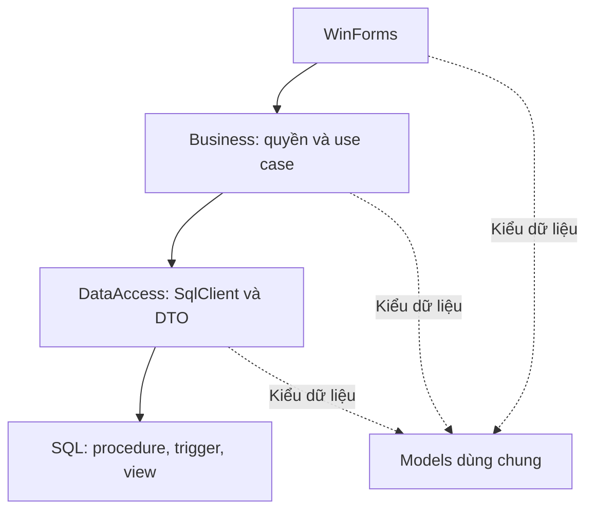

# Kế hoạch dự án WinForms — Quản lí quán cafe

**Người thực hiện:** Nguyễn Minh Phú, làm một mình.  
**Công nghệ:** C# WinForms .NET 10.0 LTS, SQL Server.  
**Thiết kế:** SQL xử lý nghiệp vụ dữ liệu; C# xử lý giao diện, xác thực và quyền thao tác.  
**Phiên bản kế hoạch:** 3.2 — 08/10/2026. Hồ sơ task con nằm trong nhóm; duyệt cả bộ plan, đợt test và đợt debug riêng; giữ nguyên chi tiết T01–T32.

## 1. Mục tiêu và phạm vi

Làm một ứng dụng quản lý một quán café với một kho chung: đăng nhập, bán hàng tại quán/mang đi/giao hàng, menu/công thức, khách hàng/ưu đãi/điểm, nhập/xuất/kiểm kê, nhân sự/chấm công/lương, thu chi/công nợ/tài sản và báo cáo.

Chạy trước trên một máy với SQL Server; kiểm thử đồng thời bằng hai session trên cùng máy. Chỉ triển khai LAN khi đã kiểm chứng kết nối và quyền. Không cần API server, website hoặc microservice cho phạm vi này.

Nguồn hiện tại là `DB_Schema.sql` và `Insert_Data.sql` của `QuanLyCafe_ERP_V2`: **35 bảng, 2 view, 4 procedure nghiệp vụ và 1 table type thanh toán**. Các đối tượng ghi “bổ sung/sửa” trong tài liệu là thiết kế đích, cần được thực hiện ở task tương ứng; không được coi là đã có trong hai file SQL.

Tài liệu này thay bản kế hoạch trước: mục 2–11 là thiết kế; **toàn bộ việc cần thực hiện nằm tại mục 12, theo thứ tự T01–T32**. Không có lịch theo tuần, bảng migration riêng lặp lại backlog hoặc checklist nghiệm thu rải ở nhiều mục.

Không đưa vào phạm vi: nhiều chi nhánh, offline đồng bộ, size/topping có công thức riêng, đặt bàn, gộp/tách hóa đơn, hoàn tiền sau thanh toán, đổi điểm thành tiền, kết nối cổng thanh toán, đối soát giao hàng và kế toán giá vốn đầy đủ. Thu nhiều phương thức là chia số tiền trả, không phải tách hóa đơn.

## 2. Thiết kế kiến trúc

App dùng ba tầng và một project Models chung. Backend nghiệp vụ ở thư viện C# và SQL Server, cùng process WinForms; không có backend HTTP riêng.

| Thành phần | Trách nhiệm |
|---|---|
| `CafeManager.WinForms` | Form/UserControl, binding, nhập dữ liệu, loading, điều hướng và in |
| `CafeManager.Business` | Xác thực/kiểm tra quyền, chuẩn hóa request, điều phối use case, dịch lỗi nghiệp vụ |
| `CafeManager.DataAccess` | Query có tham số, TVP, gọi procedure, ánh xạ DTO; không tính lại tiền/kho |
| `CafeManager.Models` | Entity cần dùng, request, DTO, các trạng thái; không tham chiếu UI/SqlClient |
| SQL Server | Tính nghiệp vụ chính thức, giữ snapshot, thực hiện transaction, ràng buộc và tổng hợp báo cáo |

UI không chứa SQL. BLL không chứa MessageBox/control. DAL không quyết định quyền menu. `Program.cs` nối dependency; không tạo generic repository/UnitOfWork hoặc hàng chục interface rỗng trước khi cần.

## 3. Công nghệ và cấu trúc code

Ảnh đã xác nhận lựa chọn **.NET 10.0 LTS**. WinForms target `net10.0-windows`; class library target tương thích. Kiểm chứng SDK, Visual Studio, Designer và máy đích ở T01, không tự đổi sang .NET Framework.

| Đường dẫn | Nội dung |
|---|---|
| `src/CafeManager.WinForms/Forms/` | LoginForm, MainForm, dialog |
| `src/CafeManager.WinForms/Modules/` | Sales, Inventory, Customers, HumanResources, Finance, Reports |
| `src/CafeManager.WinForms/Printing/` | PrintDocument, preview, phân trang |
| `src/CafeManager.Business/Services/` | Auth, Sales, Inventory, Customer, Employee, Payroll, Finance, Report |
| `src/CafeManager.Business/Security/` | Session, permission, PasswordHasher |
| `src/CafeManager.DataAccess/Repositories/` | Query/procedure theo phân hệ; không một repository cho mọi bảng |
| `src/CafeManager.DataAccess/ConnectionFactory.cs` | Tạo connection từ cấu hình |
| `src/CafeManager.Models/` | Entities, Requests, Dtos, States |
| `tests/CafeManager.Tests/` | Unit test cần thiết và integration SQL Server thật |
| `database/` | Baseline, seed và migrations theo task |
| `docs/` | Kế hoạch này và kết quả kiểm thử |
| `README.md`, `AGENTS.md`, `global.json` | Cài đặt, quy ước làm việc và SDK |

Dùng ADO.NET `Microsoft.Data.SqlClient`, không trộn thêm EF Core/Dapper. Hash/verify mật khẩu ở C# bằng `Microsoft.Extensions.Identity.Core`; không tự viết MD5/SHA256. Control WinForms chuẩn và xUnit đủ cho giai đoạn đầu.

Các query async, connection dispose sau thao tác. C# dùng decimal cho tiền/định mức, int cho số ly/identity. DTO không trả SqlDataReader hoặc SqlTransaction lên form. Không sửa `.Designer.cs` cho logic nghiệp vụ.

## 4. Phân hệ và database

| Phân hệ | Bảng/view hiện có |
|---|---|
| Đăng nhập, nhân sự | `TAIKHOAN`, `VAITRO`, `NHANVIEN`, `CHUCVU` |
| Bàn | `BAN`, `KHUVUC`, `vw_TrangThaiBan` |
| Menu, công thức | `SANPHAM`, `DANHMUC_SP`, `CONGTHUC`, `NGUYENVATLIEU` |
| Bán hàng | `HOADON`, `CHITIET_HD`, `CHITIET_THANHTOAN`, `PHUONGTHUCTT`, `TIEUHAO_HOADON` |
| Giao hàng | `DOITACGIAOHANG` và các cột giao hàng của `HOADON` |
| Khách, ưu đãi | `KHACHHANG`, `HANGTHANHVIEN`, `LICHSU_DIEM`, `KHUYENMAI` |
| Nhập hàng | `NHACUNGCAP`, `PHIEUNHAP`, `CHITIET_PN` |
| Xuất, kiểm kê | `PHIEUXUAT`, `CHITIET_PX`, `PHIEUKIEMKE`, `CHITIET_KK` |
| Chấm công, lương | `CALAMVIEC`, `CHAMCONG`, `BANGLUONG` |
| Thu chi, tài sản | `DANHMUC_THUCHI`, `PHIEUTHUCHI`, `TAISAN_CODINH` |
| Công nợ | `CONGNO_NCC`, `THANHTOAN_CONGNO`, `vw_CongNoNCC` |

Không dùng seed làm thay thế cho chức năng quản trị: mỗi phân hệ phải tạo và xử lý được giao dịch mới. Bảng nhỏ có thể dùng chung tab/editor; không bắt buộc 35 form riêng.

## 5. Tận dụng SQL: thiết kế đích

**Quyết định:** mọi nghiệp vụ ảnh hưởng đồng thời nhiều bảng hoặc số dư chạy trong SQL. C# không tự tính số dư cuối, không chốt trạng thái tài chính bằng UPDATE rời, không mở nhiều transaction cho một use case.

### 5.1. Đối tượng hiện có được giữ

- `TR_CTHD_TongTien`: tính tổng món sau thay đổi chi tiết; `HOADON.ThanhTien` computed.
- `TR_CTPN_Kho`, `TR_CTPX_Kho`, `TR_TieuHao_Kho`: tác động tồn theo tập dữ liệu, chỉ cập nhật một lần.
- `TR_LichSuDiem`: số dư/hạng theo lịch sử; không sửa/xóa lịch sử để đổi số dư.
- `TR_CTTT_KiemTra`, `TR_HD_Chot`: bảo vệ phân bổ và chứng từ chốt; rà lại việc tính tổng lặp khi tối ưu.
- `TR_PhieuNhap_Tong`, `TR_CongNo`, `TR_TraNo`, `TR_PhieuChi_LichSu`, `TR_DMTC_LichSu`: bảo vệ nguồn nhập/nợ/chi.
- `TR_KK_LichSu`: khóa chi tiết kiểm kê; bổ sung khóa cả header.
- `vw_TrangThaiBan`, `vw_CongNoNCC`: dữ liệu dẫn xuất, không lưu lại một bản trạng thái trùng ở C#.
- `BANGLUONG.ThucLinh` computed và UNIQUE nhân viên/kỳ: không ghi đè computed column.
- PK/FK/CHECK/UNIQUE, filtered index SDT và bàn mở: chốt bảo vệ sau kiểm tra input.

### 5.2. Các contract SQL cần hoàn thiện

| Use case | Thiết kế SQL | C# làm gì | Task |
|---|---|---|---|
| Cấp mã | Sequence và procedure cấp mã, khởi tạo tránh seed | Nhận mã/DTO, không MAX+1 | T03 |
| Tạo/sửa khách | Khởi tạo số dư/hạng theo ngưỡng; khóa đường sửa điểm trực tiếp | Chuẩn hóa input | T12 |
| Chính sách hạng/điểm | Procedure thay chính sách và tái phân hạng; điều chỉnh bằng lịch sử | Quyền admin, hiển thị | T13 |
| Preview ưu đãi | Hàm inline hoặc query SQL dùng cùng công thức checkout | Gọi preview, không là nguồn tính chính thức | T13 |
| Tạo/sửa đơn | `sp_TaoHoaDon`, `sp_SuaDongHoaDon` — bổ sung; khóa/version header và giữ giá snapshot | Input, chọn dòng, refresh | T14 |
| Checkout | Sửa `sp_ThanhToanHoaDon`: tự tính ưu đãi, kiểm tra preview, TVP, tiền/kho/điểm trong một transaction | Gửi phân bổ, xử lý kết quả/timeout | T15 |
| Hủy đơn | Giữ `sp_HuyHoaDon` | Xác nhận, gọi, refresh | T16 |
| Giao hàng | Procedure chuyển trạng thái đúng trình tự, giữ tài chính | Hiển thị tiến độ | T18 |
| Thu/chi | Procedure ghi chi hệ thống; FK nguồn nhập/lương và unique | Editor chi thường, quyền | T19 |
| Nhập hàng | `sp_LapPhieuNhap` — bổ sung, TVP; tồn/chi trả ngay/nợ/chốt trong một transaction | Nháp trong bộ nhớ | T20 |
| Xuất hàng | `sp_LapPhieuXuat` — bổ sung, TVP; trừ tồn/chốt nguyên tử | Nháp và loại xuất | T21 |
| Kiểm kê | Hoàn thiện `sp_ChotKiemKe`; snapshot, khóa header và chốt một lần | Ghi số đếm/lý do | T22 |
| Trả nợ | Hoàn thiện `sp_TraCongNo`; ngày nguồn, cấp mã chi, giữ lịch sử | Nhập số tiền, đọc số dư | T23 |
| Chấm công | Procedure chống overlap theo nhân viên, khóa kỳ lương | Nhập giờ/trạng thái | T25 |
| Chốt/chi lương | `sp_ChotBangLuong`, `sp_ChiLuong` — bổ sung; tính/snapshot/nguồn chi một lần | Duyệt khoản bổ sung và hiển thị | T26 |
| Báo cáo | Query/procedure aggregate theo ngày và nguồn; phân trang | Filter, grid, chart | T28 |

Tên procedure “bổ sung” là contract đích; không gọi trước khi migration của task đã được thực thi. Mỗi task triển khai SQL → integration test → DAL → BLL → UI. Không tạo toàn bộ procedure trước rồi bỏ quên kiểm thử từng phân hệ.

### 5.3. Tối ưu đúng chỗ

Một lời gọi procedure cho một giao dịch: checkout không tách thành gọi giảm giá, trừ kho, chốt, cộng điểm. Một TVP cho nhiều dòng, không loop roundtrip từng dòng. Khi dùng trigger cũ để cập nhật số dư, procedure không cập nhật lại cùng số dư.

Trigger/ràng buộc giữ bảo vệ tối thiểu; tính nghiệp vụ phức tạp ở procedure. Không giữ nhiều bản công thức ưu đãi ở BLL, view và procedure khác nhau: dùng cùng biểu thức SQL có thể tái sử dụng, không scalar UDF gọi lặp từng dòng báo cáo khi có inline/set-based.

Procedure sở hữu transaction; app gọi trực tiếp. TRY/CATCH, XACT_ABORT, kiểm tra trạng thái transaction và khóa phạm vi liên quan. Transaction không bao gồm thời gian nhân viên đếm kho, nhập dữ liệu hoặc in.

Chưa thể nói “tối ưu hết” khi chưa đo engine thật. T29 đo actual plan, IO/TIME, roundtrip và cost ghi; chỉ thêm index/sửa query cho điểm nghẽn có bằng chứng. Không chuyển hash mật khẩu, định dạng hóa đơn, layout và quyền menu sang SQL vì các việc đó không thuộc DB.

## 6. Bán hàng, ưu đãi và thanh toán

### 6.1. Đơn mở

Tại quán bắt buộc bàn, không đối tác. Mang đi không bàn/đối tác. Giao hàng không bàn, có đủ tên/SDT/địa chỉ/trạng thái; đối tác có thể NULL nếu tự giao. Khách vãng lai dùng MaKH NULL. Nhân viên lấy từ session; giờ nghiệp vụ dùng quy ước SQL Server của quán.

Tạo header tổng/giảm 0 trước chi tiết. Thêm dòng lấy giá menu hợp lệ, lưu `CHITIET_HD.GiaBan`; sửa số lượng giữ giá đã lưu. Hai dòng cùng sản phẩm khác giá hoặc ghi chú không gộp. Sửa/xóa theo MaDong và kiểm tra đúng MaHD.

`sp_SuaDongHoaDon` khóa đơn mở → hạ giảm giá cũ về hợp lệ trước thay đổi → sửa dòng → trigger tính tổng → SQL tính lại preview → trả DTO. Một lỗi rollback toàn bộ. Form cũ bị báo xung đột khi version không khớp; unique index bảo đảm một đơn mở mỗi bàn.

### 6.2. Công thức tài chính chính thức

| Giá trị | Công thức / nguồn |
|---|---|
| Tiền món | SUM(số lượng × giá snapshot dòng) |
| Tỷ lệ giảm | KM được chọn và còn hiệu lực tại ngày lập; nếu không KM thì hạng khách trước checkout; không cộng dồn |
| Giảm giá | ROUND(tiền món × tỷ lệ / 100, 0), không giảm ship |
| Phải trả | Tiền món + ship − giảm |
| Phí đối tác | ROUND((tiền món − giảm) × tỷ lệ đối tác lúc chốt / 100, 0); chi phí quán |
| Điểm mua | FLOOR((tiền món − giảm) / 1000); không cộng ship/phí đối tác |

Chương trình cùng ngày hợp lệ, hai đầu ngày áp dụng được. Hạng có ngưỡng 0 và chọn ngưỡng cao nhất ≤ điểm. Sửa chính sách tái tính hạng nguyên tử; điều chỉnh điểm admin tạo lịch sử có lý do, không UPDATE số dư.

SQL checkout phải tính lại ưu đãi và snapshot nguồn/tỷ lệ/tiền giảm. Nếu preview được khách xác nhận không còn khớp, trả lỗi yêu cầu xác nhận số mới; không thu theo giá cũ. Không suy tỷ lệ cho đơn lịch sử chỉ biết tiền giảm rồi coi đó là dữ liệu thật.

### 6.3. Checkout nguyên tử

Khóa header mở → tính tổng/ưu đãi → xác nhận preview → kiểm tra phân bổ → snapshot công thức/tiêu hao → cập nhật tồn qua trigger → ghi thanh toán → snapshot phí → chốt → ghi điểm → trả kết quả. Bất kỳ lỗi nào rollback tiền, tồn, điểm và trạng thái.

TVP `dbo.DanhSachThanhToan` hiện có gồm MaPT, SoTien, MaThamChieu. Tổng phân bổ bằng số phải trả, phương thức tồn tại/được hỗ trợ; ẩn PT010 vì chưa có đổi điểm. Bill giảm 100% và ship 0 dùng TVP rỗng, không tạo dòng tiền 0 trái CHECK; vẫn tiêu hao/chốt đúng.

Tiền đưa/thối không phải số phân bổ: bill 81.000, đưa 100.000 thì lưu thu 81.000, thối 19.000. Baseline chưa lưu tiền đưa/thối; in lại không bịa thông tin không được lưu.

Nhấn lặp/hai cửa sổ: một lần chốt. Timeout sau gửi: đọc lại MaHD và trạng thái trước xử lý tiếp, không tự retry thu tiền. In sau commit; lỗi in không gọi checkout lại. Đơn đã trả không sửa tài chính, chỉ chuyển tiến độ giao theo contract.

Hủy qua `sp_HuyHoaDon` chỉ cho đơn mở chưa tiền/tiêu hao; không hoàn tồn vì chưa bán. Đã pha nhưng hủy: ghi xuất hủy lượng thực dùng, không đồng thời ghi tiêu hao bán cùng lượng. Hoàn tiền đơn đã trả ngoài phạm vi.

## 7. Kho, nhập hàng và công nợ

Nguyên liệu có một đơn vị chuẩn: 18g café = 0,018Kg nếu nguyên liệu tính Kg. Tiền VND dùng decimal(18,0), lượng dùng decimal(18,4), số ly int. Không đổi đơn vị sau phát sinh mà không có quy trình chuyển đổi được kiểm chứng.

Tồn/điểm mở sổ phải có mốc và nguồn lưu, không chỉnh lặp. Sau mở sổ, editor không sửa tồn; tiền sử seed không được cộng lại vào số dư đã phát sinh. Số dư cần đối chiếu từ đúng mốc, không giả định bắt đầu từ 0.

### 7.1. Nhập

Soạn nháp trong bộ nhớ, chưa đổi tồn. `sp_LapPhieuNhap`: cấp mã → header tổng 0 → TVP chi tiết → trigger cộng kho/tính tổng → ghi chi trả ngay nếu có → ghi nợ nếu có → chốt → trả kết quả. Số trả ngay trong [0,tổng], nợ = tổng − trả ngay; không nợ/chi 0.

Mỗi NVL một dòng theo PK hiện có. Tổng nhập là tổng ROUND(lượng × giá nhập theo đơn vị,0) từng dòng. Ghi trả ngay cần FK `PHIEUTHUCHI.MaPN`, unique và loại chi đúng. Một lỗi rollback cả phiếu/kho/chi/nợ.

Sau chốt khóa NCC, ngày, chi tiết và tài chính; header/chi tiết đều được bảo vệ. Không xóa phiếu cũ để lùi tồn. Backfill phiếu seed thành đã chốt không chạy lại tăng tồn.

### 7.2. Xuất và kiểm kê

Một kho chung: chuyển nguyên liệu ra quầy không phải tiêu hao. Xuất chỉ `Huy do hong` hoặc `Tra hang`; procedure lưu TVP và chốt một transaction. Thiếu một dòng rollback cả phiếu; phiếu chốt không sửa/xóa. Xuất trả chưa tự xử lý hoàn tiền/cấn trừ nợ trong phạm vi này.

Kiểm kê lấy snapshot TonHeThong, nhập TonThucTe ≥ 0 và lý do khi khác. Chốt hôm nay, chưa chốt, snapshot còn khớp; lệch thì lấy lại/đếm lại. Không giữ khóa trong toàn thời gian đếm. Khi chốt tạm ngừng phát sinh liên quan; procedure bảo vệ cạnh tranh cuối cùng.

Khóa cả chi tiết và header, không reset DaDieuChinh. Chênh lệch kiểm kê chỉ tác động một lần. SQL báo cáo sổ kho có thể UNION ALL nguồn mở sổ, nhập, xuất, tiêu hao và chênh lệch kiểm kê; không tạo bản số dư thứ hai tự cộng trong C#.

### 7.3. Nợ và trả nợ

NCC lấy qua PN; một PN tối đa một nợ gốc. `vw_CongNoNCC` là số dư hiện tại, không phải số dư ngày quá khứ. Báo cáo tại ngày X chỉ tính nợ và lần trả đến X.

`sp_TraCongNo`: khóa nợ → số trả >0 và ≤ còn nợ → kiểm tra ngày không trước ngày nhập/danh mục Chi → cấp mã → ghi phiếu chi và lịch sử → trả số dư → commit. C# không ghi thêm phiếu chi. Loại hệ thống TC011 phải có khi cài mới không seed.

Hai session không trả vượt; timeout đối chiếu mã yêu cầu/phiếu chi trước retry. Trả ngay khi nhập không đồng thời tính là lần trả nợ gốc đã giảm. Không sửa lịch sử đã trả hay đổi NCC nguồn sau chốt.

## 8. Nhân sự, lương, thu chi và tài sản

### 8.1. Nhân sự và chấm công

Chức vụ độc lập vai trò app. Nhân viên nghỉ khóa tài khoản, giữ lịch sử. SDT trống thành NULL; số thực không trùng. Đổi lương không sửa snapshot kỳ cũ; không khóa admin hoạt động cuối cùng.

Chấm công datetime đầy đủ: ra > vào, có ra phải có vào; Nghỉ/Vắng không giờ. SQL procedure khóa theo nhân viên để chặn overlap, kể cả hai session. Ca nối nhau đúng thời điểm kết thúc/bắt đầu được phép. Ca qua đêm tính theo NgayLam, không đếm hai kỳ.

Kỳ có ca thiếu giờ ra phải được giải quyết/loại có lý do trước chốt; không im lặng cho 0 giờ. Kỳ đã chốt lương không sửa chấm công qua nghiệp vụ thường.

### 8.2. Chốt và chi lương

SQL tổng hợp giờ hợp lệ và snapshot mức lương/hợp đồng/khoản duyệt. Chưa tự đoán tăng ca từ ca mẫu; admin duyệt giờ thường/giờ tăng ca và tiền tăng ca theo chính sách thực tế. Không cộng giờ tăng ca vào cả giờ thường và tiền tăng ca.

Full-time = lương tháng + phụ cấp + tăng ca/thưởng − khấu trừ. Part-time = giờ thường × giá giờ + tăng ca/phụ cấp/thưởng − khấu trừ. `ThucLinh` computed giữ là nguồn số trả, chỉ một nhân viên/kỳ.

`sp_ChotBangLuong` lưu snapshot và khóa kỳ. `sp_ChiLuong` tạo một phiếu chi gắn MaBL unique, toàn bộ thực lĩnh một lần; chưa tạm ứng/chi nhiều đợt. Chốt chưa nghĩa đã trả. Thực lĩnh 0 không tạo phiếu SoTien=0.

### 8.3. Thu chi và tài sản

Chi thường cho điện/nước/thuê/sửa chữa; chi hệ thống trả nợ/trả ngay/lương chỉ qua procedure gắn nguồn. Không cho editor chọn nguồn hệ thống rồi ghi tùy ý. Bán hàng có nguồn CHITIET_THANHTOAN, không tạo thêm phiếu Thu rồi cộng cả hai.

Hồ sơ tài sản không đồng nghĩa đã ghi tiền chi; sửa chữa gắn MaTS. Khấu hao tham khảo đường thẳng từ tháng mua, không vượt nguyên giá và dồn chênh lệch làm tròn cuối kỳ. Không tự tạo phiếu chi khấu hao hoặc gọi đó là giá vốn bán.

## 9. Báo cáo và hiệu năng

SQL tổng hợp doanh thu theo NgayThanhToan, bỏ đơn mở/hủy; tiền dòng theo giá snapshot. Aggregate chi tiết và thanh toán độc lập trước JOIN để không nhân tiền do nhiều món × nhiều phương thức.

Tách tiền món sau giảm, ship, tổng khách trả và phí đối tác. Món theo tiền dòng trước giảm toàn bill nếu chưa phân bổ giảm. Thu/chi không cộng lịch sử nợ/lương lại ngoài phiếu chi. Khấu hao không phải dòng tiền. Tiền đối tác chưa đối soát không được gọi là số dư ngân hàng.

Chưa có giá vốn lịch sử nên không gọi báo cáo doanh thu/chi phí là lợi nhuận chính xác. Đối chiếu tồn từ mốc mở sổ: đầu kỳ + nhập − xuất − bán + chênh lệch kiểm kê = tồn.

Query chọn cột cần dùng, phân trang, lọc ngày bằng khoảng nửa mở; không tải toàn bảng về C#. Không NOLOCK trên tiền/kho. Index được đo theo query ở T29; không tạo index mọi cột hoặc cache trạng thái để né transaction.

## 10. Xác thực, phân quyền và xử lý lỗi

| Nhóm thao tác | ADMIN | CASH | STORE |
|---|---|---|---|
| POS/thanh toán/in/giao | Có | Có | Không |
| Tìm/thêm khách lúc bán | Có | Có | Không |
| Giá/công thức/ưu đãi/điểm | Có | Chỉ đọc | Đọc công thức |
| Nguyên liệu/nhập/xuất/kiểm kê | Có | Đọc tồn cần bán | Có |
| Nhân sự/tài khoản/lương/tài sản/thu chi | Có | Không | Không |
| Công nợ | Xem và trả | Không | Chỉ xem |
| Báo cáo tài chính | Có | Không | Không |

Login C# verify hash, SQL cung cấp account/nhân viên/role. Session không giữ password. BLL kiểm tra quyền mọi thao tác, không chỉ ẩn nút. Tài khoản SQL app có quyền tối thiểu, tài khoản migration riêng; hạn chế DML trực tiếp lên bảng số dư/lịch sử/chứng từ và cấp execute procedure.

Bootstrap chỉ được phép khi DB chưa hoàn tất thiết lập quản trị lần đầu, không
dựa riêng vào việc thiếu admin hoạt động. Trạng thái hoàn tất được lưu bền vững
tại DB, nguyên tử cùng dữ liệu bootstrap; thất bại rollback toàn bộ và thử lại
hợp lệ. Hai session đồng thời chỉ một kết quả thành công. Restart, admin bị
khóa/nghỉ việc không mở lại bootstrap; khôi phục quyền quản trị là quy trình
riêng, không là reset password qua bootstrap. Không mật khẩu mặc định/qua chat
hoặc plaintext trong file/log/session. Quyền setup tách credential runtime,
không fallback sang quyền migration. Cấu trúc lưu/khóa cụ thể chốt trong plan T06.

Nếu mọi client dùng chung SQL credential, BLL không là ranh giới chống người có credential truy cập SQL trực tiếp. Không tin tham số MaVT do client gửi như xác thực server. Dùng danh tính SQL/Windows riêng hoặc API nếu yêu cầu bảo mật tập trung về sau.

Query có tham số đúng kiểu, NULL dùng DBNull; secret nằm cấu hình local bị Git ignore. Log có mã chứng từ và lỗi, không password/secret. Phân biệt không có dữ liệu với query thất bại. Lỗi nghiệp vụ hiển thị tiếng Việt; không catch rồi trả thành công.

## 11. Quy tắc thực hiện và nghiệm thu task

- Làm một task tại một thời điểm, theo T01–T32. Phụ thuộc ghi ở mỗi task; không tạo lớp/màn hình rỗng của task sau.
- Task SQL: migration có version → DAL → BLL → UI; kiểm tra kỹ thuật tối thiểu trên engine thật trong phạm vi đã duyệt để xác nhận contract cho lớp/task sau. Kiểm thử nghiệm thu chờ duyệt đợt nhóm, commit/push chỉ khi được giao riêng. Không sửa seed để né ràng buộc.
- Task chỉ hoàn tất khi đầu ra có thật và mọi ca kiểm thử đã PASS; không tick test chưa chạy. Bug ảnh hưởng task cũ phải chạy regression liên quan.
- Quy mô S: việc giới hạn; M: phân hệ nhỏ; L: nhiều bảng/trạng thái hoặc giao dịch quan trọng. Quy mô không phải lịch tuần hoặc chia cho nhiều người.
- U: unit test; I: integration SQL Server; M: thao tác/vận hành; P: đo hiệu năng. Không phải mọi ca đều cần UI automation; kết quả manual cũng phải ghi rõ dữ liệu/thao tác/expected/actual.
- Test giao dịch phải đối chiếu toàn bộ bảng/số dư và transaction sau lỗi, không chỉ thông báo. Dùng DB test riêng, không dùng SQLite thay engine.
- Giữ test có giá trị về nghiệp vụ; không test getters hoặc sao chép mọi dòng CRUD. Checklist sau là đầy đủ theo scope đã xác định; yêu cầu mới kéo theo test mới.
- Git gốc solution, không gom cả Workspace. Không commit credential/bin/obj/backup nhạy cảm. Codex nhận một task đang làm với scope/test của task, không tự mở rộng.

Quy trình duyệt theo nhóm G01–G08, thống nhất với mục 12–13; với G02:

1. Duyệt requirements một lần cho cả nhóm G02.
2. Sau duyệt requirements, viết đầy đủ plan T06, T07, T08 và chỉ mục plans.md;
   duyệt cả bộ plan một lần trước triển khai, không duyệt từng plan riêng.
3. Sau duyệt bộ plan, triển khai tuần tự T06 → T07 → T08.
4. Hoàn thành triển khai, báo sẵn sàng và chờ duyệt đợt kiểm thử nghiệm thu nhóm.
5. Chạy nghiệm thu trên source cố định; lưu PASS/FAIL/BLOCKED/NOT RUN tại từng
   task, tổng hợp report.md. Không sửa source/migration giữa lượt nghiệm thu.
6. Có lỗi: lập bug-report tại task sở hữu, tổng hợp đợt lỗi và chờ duyệt trước
   debug. Duyệt debug bao gồm regression đúng phạm vi ảnh hưởng; bug mới ngoài
   đợt đã duyệt cần duyệt bổ sung.
7. Chỉ commit/push khi người dùng giao riêng cho bàn giao G02.

Trong triển khai được build, kiểm tra compile SQL/migration và smoke check tối
thiểu để xác nhận đầu ra task trước dùng được cho task sau, trong phạm vi đã
duyệt. Ghi riêng là kiểm tra kỹ thuật với lệnh/môi trường/kết quả; không thay
checklist nghiệm thu hoặc tự đánh dấu PASS Txx-Kxx. Phát hiện blocker, thiếu
đầu ra phụ thuộc hoặc cần đổi phạm vi/contract ngoài duyệt phải báo rõ để người
dùng quyết định. Việc sửa kỹ thuật không phải cho phép tự debug bug nghiệm thu.

## 12. Kế hoạch triển khai và nghiệm thu theo task

Thực hiện tuần tự **T01 → T32**, một người làm. Tất cả task ban đầu ở trạng thái **Chưa bắt đầu**; tài liệu này không xác nhận task hay kiểm thử đã hoàn tất. Không phân lịch theo tuần. Quy mô S/M/L diễn tả độ rộng công việc, không phải số người.

Mỗi task dưới đây có cùng mẫu: tên, mô tả, phạm vi, quy mô, phụ thuộc, đầu ra, kiểm thử và điều kiện hoàn tất. Mã kiểm thử dùng để ghi expected/actual và kết quả PASS/FAIL trong biên bản của task. Kiểm thử SQL chạy trên SQL Server thật, với DB test riêng.

### Nhóm task lớn để duyệt và bàn giao

| Nhóm | Task con | Chủ đề chung | Phụ thuộc trước nhóm |
|---|---|---|---|
| G01 — Nền tảng kỹ thuật và dữ liệu | T01–T05 | Môi trường/repo, SQL baseline, contract/migration/cấp mã, solution và DAL/test nền | Không |
| G02 — Truy cập ứng dụng và cấu hình nền | T06–T08 | Bootstrap/login/quyền, khung UI và danh mục dùng chung | T05 |
| G03 — Dữ liệu phục vụ bán hàng | T09–T13 | Nguyên liệu, menu/công thức, bàn, khách/hạng và ưu đãi/điểm | T08 |
| G04 — Bán hàng và vòng đời hóa đơn | T14–T18 | Tạo/sửa đơn, checkout, POS/hủy, in/tra cứu và giao hàng | T13 |
| G05 — Kho, nguồn chi và công nợ | T19–T23 | Thu chi nền, nhập/trả ngay/nợ, xuất, kiểm kê và trả nợ | T18 |
| G06 — Nhân sự, công và lương | T24–T26 | Nhân viên/tài khoản, chấm công và chốt/chi lương | T23 |
| G07 — Tài sản, báo cáo và hiệu năng dữ liệu | T27–T29 | Tài sản/khấu hao tham khảo, báo cáo/đối chiếu và tối ưu SQL có số đo | T26 |
| G08 — Vận hành, nghiệm thu và bàn giao | T30–T32 | Backup/restore/cài sạch, regression xuyên luồng và publish | T29 |

Đây là lớp nhóm quản lý duyệt, không thay 32 task bên dưới. Giữ nguyên ID, nội
dung, phạm vi, đầu ra, phụ thuộc, thứ tự và **325 ca Txx-Kxx**. Không gộp checklist
hoặc bỏ test task con. Thực hiện một task con tại một thời điểm theo T01 → T32;
không đổi thứ tự khi có cùng nhóm.

Hồ sơ nhóm: `docs/tasks/g01-nen-tang-ky-thuat-du-lieu/requirements.md` cho G01;
các nhóm sau dùng slug tương ứng. Plan/kết quả/bug của task con đặt trong
`docs/tasks/gXX-<slug>/tXX-<slug>/`; báo cáo cuối nhóm đặt tại
`docs/tasks/gXX-<slug>/report.md`, tham chiếu hồ sơ task con.

Requirements/plan/biên bản đã có của T01 được giữ và kế thừa vào G01, không duyệt
hoặc làm lại chỉ vì đổi cách nhóm. Requirements T02 đã soạn là hồ sơ tham chiếu,
không còn là điểm duyệt riêng; phạm vi T02 được duyệt qua requirements G01.

Quy trình chốt lại ngày 08/10/2026: viết đủ plan của nhóm, duyệt cả bộ một lần,
triển khai task con lần lượt, sau đó chờ duyệt một lần cho đợt test của nhóm.
Test từng task với source cố định, lưu kết quả riêng và báo cáo tổng hợp kể cả
khi còn FAIL/BLOCKED. Bug ghi tại task sở hữu; tổng hợp đợt bug để người dùng
duyệt một lần trước khi debug toàn bộ đợt và regression các phần ảnh hưởng.
Không tự sửa bug trong đợt test. Đầu ra của task trước là đầu vào triển khai task
sau; nghiệm thu PASS được chốt trong đợt test, không giả PASS khi mới viết code.
Blocker phụ thuộc phải ghi rõ và xin quyết định nếu ngăn triển khai task sau.

G02 requirements đã được người dùng duyệt; bộ plan T06–T08 tại
`docs/tasks/g02-truy-cap-ung-dung-cau-hinh-nen/plans.md` đã được duyệt cả bộ và
đã triển khai và nghiệm thu **PASS27/27IDgốc ngày17/10/2026**; đủ điều kiện
chốt kỹ thuật, chờ bàn giao Git riêng (G02 chưa commit/push). Ma trận đối chiếu
và biên bản tại `docs/tasks/g02-truy-cap-ung-dung-cau-hinh-nen/acceptance-matrix.md`
và `report.md`. B01–B07/PKCS đã sửa/regressionPASS; Windowsidentity thật,
setupOK/thoát/restart exe vàcleanup đềuPASS. Bộ plan chốt đầy đủ
các quyết định và subcase bắt buộc tại
`docs/tasks/g02-truy-cap-ung-dung-cau-hinh-nen/requirements.md`, mục 5–6.
Mỗi quyết định có phương án/lý do/tác động SQL/DAL/BLL/UI và kiểm chứng; không
để quyết định lúc code. Giữ 27 ID T06–T08 và 325 ID toàn dự án; subcase có thể
dùng hậu tố, mỗi subcase có expected/actual và PASS/FAIL/BLOCKED/NOT RUN riêng.
Bao gồm bootstrap concurrency/rollback/restart/khóa admin; DB sạch/demo và
migration chạy lại; rehash DB/race; thay đổi quyền trong phiên/logout/async
muộn; CRUD/biên/NULL/trùng/tìm tiếng Việt đủ 7 danh mục; mã hệ thống chưa có
lịch sử; selector/PT010; số lượt đổi module cụ thể và kiểm tài nguyên; DPI150%
và Designer round-trip có bằng chứng riêng. Subcase không là tùy chọn.

### T01 — Xác nhận môi trường .NET 10 và tạo repository đúng thư mục

| Thuộc tính | Nội dung |
|---|---|
| Mô tả | Xác nhận ảnh lựa chọn framework có thể build/run thực tế, tránh bắt đầu trên template sai. |
| Phạm vi | SDK, Visual Studio, WinForms Designer, SQL instance, Git và cấu hình máy; chưa viết nghiệp vụ. |
| Quy mô | S — nền tảng phát triển |
| Phụ thuộc | Không |
| Đầu ra | Ghi phiên bản thực tế, global.json, README môi trường, repository gốc solution. |

**Tiến độ 08/10/2026:** Đã nghiệm thu kỹ thuật 7/7 ca PASS; chờ người dùng cho
phép lưu commit bàn giao. Biên bản: `docs/tasks/g01-nen-tang-ky-thuat-du-lieu/t01-moi-truong-repository/test-results.md`.

**Kiểm thử bắt buộc:**

- [x] `T01-K01` [M] Tạo form net10.0-windows và mở Designer: không lỗi.
- [x] `T01-K02` [M] Build Debug/Release và chạy form: cửa sổ mở/đóng bình thường.
- [x] `T01-K03` [M] dotnet --info khớp SDK đã pin; target đúng .NET 10, không .NET Framework.
- [x] `T01-K04` [M] Kết nối SSMS tới đúng SQL instance và xác nhận quyền tạo DB test.
- [x] `T01-K05` [M] git rev-parse --show-toplevel trả thư mục dự án, không trả D:\Workspace.
- [x] `T01-K06` [M] git status không thu gom các dự án anh em; bin/obj và cấu hình bí mật bị ignore.
- [x] `T01-K07` [M] Clone hoặc copy sạch source sang thư mục khác vẫn restore/build được.

**Điều kiện hoàn tất:** Có đủ đầu ra; các ca kiểm thử trong phạm vi đã chạy và PASS, có dữ liệu thử và kết quả đối chiếu; không còn lỗi trọng yếu của task. Lưu commit cùng biên bản kiểm thử. Nếu thay SQL, migration phải chạy được trên phiên bản trước và bảo toàn dữ liệu cũ ngoài thay đổi đã mô tả.

### T02 — Chạy và kiểm chứng SQL baseline

**Trạng thái 08/10/2026:** Đã triển khai, đủ 12/12 ca PASS trên SQL Server thật
(lượt `20261008_205557_93421dd4`). Bằng chứng ở
`docs/tasks/g01-nen-tang-ky-thuat-du-lieu/t02-sql-baseline/test-results.md` và JSON/lịch sử cạnh file.
Baseline nguồn giữ nguyên; commit bàn giao chờ người dùng cho phép, chưa chốt
Hoàn tất bàn giao. Kết quả này kế thừa từ quy trình cũ; bộ plan G01 đã được duyệt,
T03–T05 đã test/debug B01–B08 theo duyệt; G01 hiện45/45 ca nguyên bản PASS,
bổ sung runner-failure và regression B09/B10 PASS trên bản sau Save Designer;
đủ kiểm chứng kỹ thuật, chờ cho phép commit bàn giao, chưa chốt Hoàn tất nhóm.

| Thuộc tính | Nội dung |
|---|---|
| Mô tả | Kiểm tra hai file SQL đã gửi bằng engine thật trước khi dựa vào chúng để code. |
| Phạm vi | Tạo DB test, schema/seed, FK/CHECK/trigger/procedure/view; không migration mở rộng trong task này. |
| Quy mô | L — nhiều bất biến DB |
| Phụ thuộc | T01 |
| Đầu ra | Biên bản PASS/FAIL baseline; sửa lỗi thực thi được phát hiện bằng migration hoặc sửa baseline khi còn DB test mới. |

**Kiểm thử bắt buộc:**

- [x] `T02-K01` [I] Schema tạo đủ 35 bảng, 2 view, 4 procedure và 1 type TVP nghiệp vụ hiện có; mọi đối tượng compile.
- [x] `T02-K02` [I] Seed COMMIT: 10 hóa đơn, 18 dòng món, 9 đơn đã trả, 1 đơn mở B0003.
- [x] `T02-K03` [I] HD20250401 phải trả 112.500; HD20250409 81.000, phân bổ 30.000 + 51.000.
- [x] `T02-K04` [I] Tổng mọi hóa đơn/phiếu nhập khớp chi tiết; mọi đơn đã trả khớp phân bổ.
- [x] `T02-K05` [I] Seed chạy lại bị từ chối và không thay dữ liệu đã có; không chạy lại CREATE trên DB thật.
- [x] `T02-K06` [I] FK không có mã nguồn, tiền âm, số lượng 0, ngày KM ngược bị chặn; KM cùng một ngày hợp lệ.
- [x] `T02-K07` [I] Hai SDT NULL trong khách/nhân viên lưu được; SDT thực trùng bị chặn.
- [x] `T02-K08` [I] INSERT/UPDATE/DELETE nhiều dòng món và nhiều nguyên liệu: trigger cập nhật đúng từng nhóm.
- [x] `T02-K09` [I] Checkout thiếu nguyên liệu hoặc phương thức sai: không còn tiêu hao, tiền, điểm hay trạng thái mới.
- [x] `T02-K10` [I] Trả nợ vượt bị rollback cả phiếu chi/lịch sử; sửa lịch sử đã chốt bị chặn.
- [x] `T02-K11` [I] Kiểm kê hợp lệ chốt một lần; lần hai/lệch tồn/ngày cũ bị chặn.
- [x] `T02-K12` [I] Mọi nhánh lỗi procedure không để transaction mở; xem @@TRANCOUNT ở cùng session sau thử.

**Điều kiện hoàn tất:** Có đủ đầu ra; các ca kiểm thử trong phạm vi đã chạy và PASS, có dữ liệu thử và kết quả đối chiếu; không còn lỗi trọng yếu của task. Lưu commit cùng biên bản kiểm thử. Nếu thay SQL, migration phải chạy được trên phiên bản trước và bảo toàn dữ liệu cũ ngoài thay đổi đã mô tả.

### T03 — Chốt hợp đồng dữ liệu, migration và cấp mã SQL

**Trạng thái09/10/2026:** 9/9 ca PASS — B01/B03 đã sửa; runner SQL10/10 subcase
PASS, đủ100 mã concurrent. Runtime Windows app identity/config tách migration
đã xác nhận; chưa nghiệm thu toàn nhóm G01 do B08 thuộc T05.

| Thuộc tính | Nội dung |
|---|---|
| Mô tả | Định nghĩa phần SQL bổ sung có kiểm soát, cấp mã tập trung để một người triển khai tuần tự. |
| Phạm vi | Migration version, sequence/cấp mã, chuẩn tiền/NULL/trạng thái, quyền ghi các nguồn tự động; chưa triển khai toàn bộ procedure tương lai. |
| Quy mô | M — nền tảng dữ liệu |
| Phụ thuộc | T02 |
| Đầu ra | Migration đầu tiên, bảng/version lịch sử migration đơn giản, hợp đồng request/kết quả và ma trận nơi ghi. |

**Kiểm thử bắt buộc:**

- [ ] `T03-K01` [I] Áp dụng migration trên DB baseline có seed: dữ liệu cũ và FK vẫn nguyên.
- [ ] `T03-K02` [I] Chạy lại migration: nhận ra đã áp dụng hoặc từ chối rõ; không chạy tác động lần hai.
- [ ] `T03-K03` [I] Cấp đồng thời nhiều mã hóa đơn: không trùng, không đụng mã seed, đúng CHAR(10).
- [ ] `T03-K04` [I] Mã danh mục/nhân viên đúng CHAR(5); tới giới hạn thì lỗi rõ, không cắt chuỗi/lặp mã.
- [ ] `T03-K05` [I] Rollback tạo chứng từ không cần trả lại số sequence; lần sau không trùng.
- [ ] `T03-K06` [I] Thiết lập quyền app: không dùng db_owner/sa để chạy thường; đọc view và execute procedure được.
- [ ] `T03-K07` [I] Với các bảng tự động đã khóa quyền, ghi trực tiếp tiêu hao/điểm/chốt/chi hệ thống bị chặn; procedure hợp lệ vẫn chạy.
- [ ] `T03-K08` [M] Cấu hình development và tài khoản migration tách khỏi quyền app; credential không vào Git/log.
- [ ] `T03-K09` [M] Đối chiếu hợp đồng: computed columns không có setter ghi DB; tên trạng thái đúng CHECK.

**Điều kiện hoàn tất:** Có đủ đầu ra; các ca kiểm thử trong phạm vi đã chạy và PASS, có dữ liệu thử và kết quả đối chiếu; không còn lỗi trọng yếu của task. Lưu commit cùng biên bản kiểm thử. Nếu thay SQL, migration phải chạy được trên phiên bản trước và bảo toàn dữ liệu cũ ngoài thay đổi đã mô tả.

### T04 — Tạo solution 3 tầng và Models dùng chung

**Trạng thái 08/10/2026:** 7/7 PASS — source UI B07 mới đã Designer
save/reopen bằng VS18/DTE, có ảnh/bằng chứng và source không đổi. Restore,
Debug/Release/copy sạch build thành công, Form mở/đóng được; sau sửa B02 build
0 warning/0 error. Resize/DPI runtime còn thuộc lượt kiểm chứng UI T05.

| Thuộc tính | Nội dung |
|---|---|
| Mô tả | Tạo bộ khung vừa đủ để mỗi module có chỗ rõ ràng. |
| Phạm vi | 4 project src, project tests, namespace, composition root, thư mục docs/database; chưa tạo lớp rỗng mọi bảng. |
| Quy mô | S — cấu trúc code |
| Phụ thuộc | T03 |
| Đầu ra | Solution build được, project references đúng, mẫu một DTO/service/repository khi cần. |

**Kiểm thử bắt buộc:**

- [ ] `T04-K01` [M] Build toàn solution Debug/Release, không circular project reference.
- [ ] `T04-K02` [M] Models không tham chiếu UI/SqlClient; Business không tham chiếu WinForms.
- [ ] `T04-K03` [M] Form không có câu SQL hoặc connection ngoài composition root.
- [ ] `T04-K04` [M] Program khởi tạo dependency và mở đúng form ban đầu.
- [ ] `T04-K05` [M] Mở Designer sau tổ chức namespace/thư mục vẫn hoạt động.
- [ ] `T04-K06` [M] Restore từ source sạch không cần đường dẫn tuyệt đối trên máy tác giả.
- [ ] `T04-K07` [M] Không có hàng loạt generic abstraction/lớp rỗng không phục vụ task hiện tại.

**Điều kiện hoàn tất:** Có đủ đầu ra; các ca kiểm thử trong phạm vi đã chạy và PASS, có dữ liệu thử và kết quả đối chiếu; không còn lỗi trọng yếu của task. Lưu commit cùng biên bản kiểm thử. Nếu thay SQL, migration phải chạy được trên phiên bản trước và bảo toàn dữ liệu cũ ngoài thay đổi đã mô tả.

### T05 — Xây DAL, xử lý lỗi và nền kiểm thử

**Trạng thái09/10/2026:** 10/10 ca nguyên bản PASS sau sửa/regression B08,
app Windows identity riêng thật; xUnit20/20 PASS kế thừa. Kiểm chứng bổ sung
B09/B10 đã sửa và regression sau Save Designer PASS; failure runner PASS;
G01 đủ kiểm chứng kỹ thuật, chờ cho phép commit bàn giao.

| Thuộc tính | Nội dung |
|---|---|
| Mô tả | Thiết lập truy cập SQL typed/async và đường kiểm thử giao dịch để các module không tự viết khác nhau. |
| Phạm vi | ConnectionFactory, query/command có tham số, TVP, dispose, log và dịch lỗi; helper nhỏ, không generic ORM. |
| Quy mô | M — ranh giới C#/SQL |
| Phụ thuộc | T04 |
| Đầu ra | DAL nền, test database riêng, mẫu truy vấn DTO và mẫu rollback có xác nhận. |

**Kiểm thử bắt buộc:**

- [ ] `T05-K01` [I] Chuỗi có dấu, dấu nháy và SQL-injection input được lưu/tìm như dữ liệu, không thực thi lệnh.
- [ ] `T05-K02` [I] NULL, CHAR padding, decimal precision/scale và datetime ánh xạ đúng.
- [ ] `T05-K03` [I] Truy vấn không có dòng trả danh sách rỗng; lỗi kết nối trả lỗi khác, không giả thành rỗng.
- [ ] `T05-K04` [I] TVP 0/1/nhiều dòng truyền đúng cột/type, type sai báo lỗi có chẩn đoán.
- [ ] `T05-K05` [I] Gây lỗi giữa các bước của procedure nhiều bảng: SQL rollback toàn bộ; DAL dispose connection và không bọc thêm transaction ngoài.
- [ ] `T05-K06` [I] Procedure sở hữu transaction gọi trực tiếp; thử lỗi không để @@TRANCOUNT > 0.
- [ ] `T05-K07` [M] Query chậm không khóa UI; hủy/thay màn hình không update control đã dispose.
- [ ] `T05-K08` [M] Log có thao tác và mã chứng từ, không có password/connection string chứa bí mật.
- [ ] `T05-K09` [M] Lỗi đã biết được dịch đúng; lỗi chưa biết không báo thành công.
- [ ] `T05-K10` [M] Test runner chỉ dùng DB test, từ chối database production; data fixture dọn đúng phần đã tạo.

**Điều kiện hoàn tất:** Có đủ đầu ra; các ca kiểm thử trong phạm vi đã chạy và PASS, có dữ liệu thử và kết quả đối chiếu; không còn lỗi trọng yếu của task. Lưu commit cùng biên bản kiểm thử. Nếu thay SQL, migration phải chạy được trên phiên bản trước và bảo toàn dữ liệu cũ ngoài thay đổi đã mô tả.

### T06 — Bootstrap admin, đăng nhập và cấp quyền

| Thuộc tính | Nội dung |
|---|---|
| Mô tả | Dùng TAIKHOAN/VAITRO thay cho login hard-code, tách chức vụ và quyền app. |
| Phạm vi | AuthService, session, hash/verify, bootstrap một lần, logout; UI account editor đầy đủ ở T24. |
| Quy mô | M — bảo vệ mọi phân hệ |
| Phụ thuộc | T05 |
| Đầu ra | Đăng nhập thật, admin đầu tiên có hash hợp lệ, authorization BLL. |

Điều kiện duyệt plan T06: đề xuất cụ thể bootstrap DB sạch/DB demo (dữ liệu
chức vụ/nhân viên/account tối thiểu, trường nhập, transaction), DB đã có admin
hợp lệ nhưng chưa có trạng thái bootstrap khi chuyển phiên bản, quyền setup
riêng và chuyển về credential runtime. Chốt charset/length/trim/case/collation
username thống nhất UI/C#/SQL; không trim password. Chốt recheck account/nhân
viên/role trước thao tác mới, vô hiệu tham chiếu cũ và async muộn sau logout;
rehash không ghi đè password đổi sau lúc đọc và có integration test ghi DB thật.
Cấu trúc bảng/cột/procedure/lock phải được đề xuất trong plan, không coi đã có.

**Kiểm thử bắt buộc:**

- [x] `T06-K01` [M] Bootstrap chỉ khi database chưa hoàn tất thiết lập quản trị lần đầu; tạo/bật đúng một tài khoản admin với mật khẩu người dùng nhập, lưu bền vững trạng thái hoàn tất tại DB nguyên tử cùng dữ liệu bootstrap. Không dùng việc thiếu admin hoạt động làm điều kiện duy nhất.
- [x] `T06-K02` [I] Bootstrap lần hai bị chặn, không reset password hoặc tạo admin trùng.
- [x] `T06-K03` [U/M] Đúng mật khẩu thành công; sai/username không có/placeholder hash thất bại an toàn.
- [x] `T06-K04` [I/M] Tài khoản HoatDong=0 hoặc nhân viên DangLamViec=0 bị từ chối.
- [x] `T06-K05` [U] Verify cần rehash cập nhật hash đúng, không lưu plaintext.
- [x] `T06-K06` [U] ADMIN/CASH/STORE được/chặn đúng từng nhóm quyền, kể cả gọi service không qua menu.
- [x] `T06-K07` [M] Password không hiện ở log/session; UI che ký tự.
- [x] `T06-K08` [M] Đăng xuất xóa session và đóng màn hình có quyền; không thao tác bằng session cũ.
- [x] `T06-K09` [M] Lỗi DB khi login không biến thành login thành công hoặc thông báo sai password đơn thuần.
- [x] `T06-K10` [I] Tên login trùng theo collation đã chọn bị chặn; chuẩn hóa khoảng trắng nhất quán.

**Điều kiện hoàn tất:** Có đủ đầu ra; các ca kiểm thử trong phạm vi đã chạy và PASS, có dữ liệu thử và kết quả đối chiếu; không còn lỗi trọng yếu của task. Lưu commit cùng biên bản kiểm thử. Nếu thay SQL, migration phải chạy được trên phiên bản trước và bảo toàn dữ liệu cũ ngoài thay đổi đã mô tả.

### T07 — Khung giao diện và điều hướng module

| Thuộc tính | Nội dung |
|---|---|
| Mô tả | Tạo MainForm và quy ước bố cục cho một app quản trị có POS. |
| Phạm vi | Sidebar, content panel, UserControl/dialog, loading, thông báo; chưa triển khai tất cả màn hình. |
| Quy mô | S — một khung UI |
| Phụ thuộc | T06 |
| Đầu ra | MainForm dùng được; style cơ bản và navigation theo vai trò. |

G02 chỉ làm shell và các màn T06–T08. CASH/STORE có màn bắt đầu hợp lệ, thể hiện
chức năng chưa triển khai; không giao dịch POS/kho giả hoặc dựng toàn bộ module
tương lai. Mẫu chung loading/rỗng/lỗi/xung đột/kết quả chưa biết áp dụng khi màn
hiện có cần. AppTheme theo UI Style Guide Espresso/Kem/Caramel. Plan bắt buộc
Designer save/close/reopen, kiểm bản sau Save, keyboard/focus và hai kích thước
1280×720/1366×768 tại DPI100/125/150%; không giảm ca K04 vì có subcase bổ sung.

**Kiểm thử bắt buộc:**

- [x] `T07-K01` [M] Login thành công vào MainForm, hiển thị đúng tên nhân viên/vai trò.
- [x] `T07-K02` [M] Menu theo role; không tồn tại hai MainForm/session khác nhau ngoài ý định.
- [x] `T07-K03` [M] Đổi module nhiều lần không mở connection hoặc giữ event handler/control trùng.
- [x] `T07-K04` [M] Resize/DPI 100% và 125% không che menu, nút và cột chính.
- [x] `T07-K05` [M] Nhấn thao tác đang loading không gửi lặp; xong/lỗi đều mở lại trạng thái nút đúng.
- [x] `T07-K06` [M] Dialog hủy không ghi; dialog lưu refresh đúng module.
- [x] `T07-K07` [M] Đóng app khi có input chưa lưu hỏi bỏ/lưu phù hợp; đơn đã lưu không bị xóa.

**Điều kiện hoàn tất:** Có đủ đầu ra; các ca kiểm thử trong phạm vi đã chạy và PASS, có dữ liệu thử và kết quả đối chiếu; không còn lỗi trọng yếu của task. Lưu commit cùng biên bản kiểm thử. Nếu thay SQL, migration phải chạy được trên phiên bản trước và bảo toàn dữ liệu cũ ngoài thay đổi đã mô tả.

### T08 — Các danh mục nền cho toàn ứng dụng

| Thuộc tính | Nội dung |
|---|---|
| Mô tả | Có dữ liệu tham chiếu hợp lệ trước khi triển khai giao dịch. |
| Phạm vi | Danh mục sản phẩm, NCC, phương thức TT, đối tác, loại thu/chi, chức vụ, ca; không biến mỗi bảng thành một module riêng. |
| Quy mô | M — nhóm CRUD nền |
| Phụ thuộc | T07 |
| Đầu ra | Các tab quản trị và dữ liệu hệ thống phục vụ app cài mới không seed. |

Điều kiện duyệt plan T08: có ma trận đọc/thêm/sửa/xóa cho từng ADMIN/CASH/STORE
trên DANHMUC_SP, NHACUNGCAP, PHUONGTHUCTT, DOITACGIAOHANG, DANHMUC_THUCHI,
CHUCVU, CALAMVIEC. Tách quản trị khỏi đọc phục vụ use case, liệt kê trường được
đọc (không mặc nhiên lộ trường tài chính); BLL kiểm kể cả service gọi trực tiếp.

Chốt mã chi lương/trả nợ/trả ngay từ schema/seed/contract và trường được sửa.
Seed có TC005 loại Chi cho lương, TC011 loại Chi trả nợ; schema sp_TraCongNo
dùng TC011. Chưa có contract chi lương T26 hoặc mã chi trả ngay hệ thống được
xác lập trong source G01; phải đề xuất trước duyệt plan, không suy từ tên TC008.
Cấm đổi mã/loại hoặc xóa bản ghi hệ thống ngay cả chưa có lịch sử. Migration
DB sạch/demo và chạy lại không tạo trùng/ghi đè cấu hình hợp lệ/thay lịch sử.
Chốt cách nhập/cấp mã từng danh mục; sp_CapMa G01 chỉ HD/DM/NV theo contract.
Chưa triển khai nhập hàng T20 hoặc chi lương T26.

Chốt tiêu chí hỗ trợ phương thức và selector/service checkout, không dựa vào
tên. PT010 bị loại tại contract/service; chốt phương thức ADMIN thêm có được
dùng ngay hay cần cấu hình/xác nhận hỗ trợ. T08 kiểm selector/service, không
tạo checkout UI T15. Đây là yêu cầu cần thiết kế, chưa có selector trong G01.

**Kiểm thử bắt buộc:**

- [x] `T08-K01` [I/M] Thêm/sửa/tìm từng danh mục hợp lệ, mở lại app vẫn có dữ liệu.
- [x] `T08-K02` [I/M] Tên rỗng/whitespace/quá dài, SDT NCC trùng, FK sai bị từ chối rõ.
- [x] `T08-K03` [I] Tỷ lệ đối tác -1/>100, phụ cấp âm, hệ số <1 và giờ ca bắt đầu=kết thúc bị chặn.
- [x] `T08-K04` [I] Tỷ lệ 0/100 và ca qua đêm được xử lý đúng quy ước.
- [x] `T08-K05` [I] Xóa danh mục chưa dùng được; danh mục có lịch sử bị từ chối, không cascade lịch sử.
- [x] `T08-K06` [I] TC011 và loại chi trả ngay/chi lương hệ thống tồn tại khi không chạy seed demo.
- [x] `T08-K07` [I/M] Người dùng không đổi Thu/Chi của danh mục đã gắn chi hệ thống; không xóa phương thức đã dùng.
- [x] `T08-K08` [M] PT010 không xuất hiện ở danh sách checkout; tên phương thức không có nghĩa đã tích hợp online.
- [x] `T08-K09` [U/M] CASH/STORE không sửa giá trị cấu hình tài chính hoặc quyền không được cấp.
- [x] `T08-K10` [I] Sửa tỷ lệ hiện tại không đổi snapshot phí đối tác của đơn cũ.

**Điều kiện hoàn tất:** Có đủ đầu ra; các ca kiểm thử trong phạm vi đã chạy và PASS, có dữ liệu thử và kết quả đối chiếu; không còn lỗi trọng yếu của task. Lưu commit cùng biên bản kiểm thử. Nếu thay SQL, migration phải chạy được trên phiên bản trước và bảo toàn dữ liệu cũ ngoài thay đổi đã mô tả.

### T09 — Nguyên liệu, đơn vị và số dư mở sổ

| Thuộc tính | Nội dung |
|---|---|
| Mô tả | Quản lý nguyên liệu mà không cho CRUD trở thành đường sửa tồn tùy ý. |
| Phạm vi | NGUYENVATLIEU, tồn hiện tại, mốc mở sổ có nguồn lưu; chưa nhập/xuất thông thường. |
| Quy mô | M — danh mục có số dư |
| Phụ thuộc | T08 |
| Đầu ra | Màn hình nguyên liệu, quy trình tồn đầu kỳ một lần có kiểm soát, hợp đồng đối chiếu. |

**Kiểm thử bắt buộc:**

- [ ] `T09-K01` [I/M] Nguyên liệu mới có tồn 0, tên/đơn vị hợp lệ; số lượng 4 chữ số lẻ không bị mất.
- [ ] `T09-K02` [I] Mở sổ số dư hợp lệ ghi tồn và dấu vết/mốc trong cùng transaction; có lỗi rollback cả hai.
- [ ] `T09-K03` [I] Mở sổ lần hai hoặc sau khi đã phát sinh giao dịch bị chặn.
- [ ] `T09-K04` [I/M] Số âm/quá precision/đơn vị trống bị từ chối, không âm thầm làm tròn sai.
- [ ] `T09-K05` [M] Ví dụ 18g quy đổi nhập 0,018Kg; preview/DB cùng đơn vị.
- [ ] `T09-K06` [I] Sửa tên không đổi tồn; đổi đơn vị sau có công thức/giao dịch bị chặn hoặc qua migration có kiểm soát.
- [ ] `T09-K07` [I/M] User CASH chỉ đọc; ADMIN/STORE không sửa trực tiếp tồn từ editor sau mở sổ.
- [ ] `T09-K08` [I] Xóa nguyên liệu đã được công thức/phiếu/tiêu hao tham chiếu bị chặn.
- [ ] `T09-K09` [M] Danh sách tồn refresh sau giao dịch, không dùng cache làm kết quả chốt.

**Điều kiện hoàn tất:** Có đủ đầu ra; các ca kiểm thử trong phạm vi đã chạy và PASS, có dữ liệu thử và kết quả đối chiếu; không còn lỗi trọng yếu của task. Lưu commit cùng biên bản kiểm thử. Nếu thay SQL, migration phải chạy được trên phiên bản trước và bảo toàn dữ liệu cũ ngoài thay đổi đã mô tả.

### T10 — Sản phẩm và công thức nguyên liệu

| Thuộc tính | Nội dung |
|---|---|
| Mô tả | Chuẩn bị menu có thể bán và kiểm soát tiêu hao. |
| Phạm vi | SANPHAM/CONGTHUC, editor công thức nguyên tử; ghi chú size/topping không tính riêng. |
| Quy mô | M — menu và nhiều dòng công thức |
| Phụ thuộc | T09 |
| Đầu ra | Menu, ngừng/bật bán, thay công thức nguyên tử. |

**Kiểm thử bắt buộc:**

- [ ] `T10-K01` [I/M] Tạo sản phẩm giá dương, đúng danh mục; thêm nhiều định mức hợp lệ.
- [ ] `T10-K02` [I] Giá 0/âm, định mức 0/âm, FK sai hoặc cặp SP/NVL trùng bị chặn.
- [ ] `T10-K03` [I] Một dòng công thức lỗi khiến toàn bộ thay công thức rollback, công thức cũ còn nguyên.
- [ ] `T10-K04` [I/M] Không bật bán/checkout món không công thức; bánh thành phẩm định mức 1 hoạt động.
- [ ] `T10-K05` [M] Ngừng bán làm món không chọn mới; đơn mở đang chứa món cần sửa, không tự bỏ món.
- [ ] `T10-K06` [I] Đổi giá menu không đổi GiaBan của dòng hóa đơn cũ.
- [ ] `T10-K07` [I] Đổi công thức không đổi TIEUHAO_HOADON đã lưu.
- [ ] `T10-K08` [I] Lưu công thức đồng thời checkout bị khóa/đọc snapshot nhất quán, không công thức nửa cũ nửa mới.
- [ ] `T10-K09` [U/M] CASH không sửa menu, STORE chỉ đọc công thức; ADMIN quản trị được.
- [ ] `T10-K10` [I/M] Xóa sản phẩm có lịch sử bị chặn; tìm/lọc danh mục và mở lại hiển thị đúng.

**Điều kiện hoàn tất:** Có đủ đầu ra; các ca kiểm thử trong phạm vi đã chạy và PASS, có dữ liệu thử và kết quả đối chiếu; không còn lỗi trọng yếu của task. Lưu commit cùng biên bản kiểm thử. Nếu thay SQL, migration phải chạy được trên phiên bản trước và bảo toàn dữ liệu cũ ngoài thay đổi đã mô tả.

### T11 — Bàn, khu vực và sơ đồ bàn

| Thuộc tính | Nội dung |
|---|---|
| Mô tả | Dùng trạng thái dẫn xuất theo đơn thay vì tự đồng bộ cột trạng thái. |
| Phạm vi | BAN/KHUVUC/vw_TrangThaiBan, sơ đồ và tìm đơn mở; tạo đơn nghiệp vụ ở T14. |
| Quy mô | S — danh mục và view |
| Phụ thuộc | T10 |
| Đầu ra | Sơ đồ bàn đúng trạng thái, chọn bàn trả đúng mã đơn mở. |

**Kiểm thử bắt buộc:**

- [ ] `T11-K01` [I/M] CRUD bàn/khu vực hợp lệ và quan hệ khu vực được giữ sau reload.
- [ ] `T11-K02` [I] Tên trống/quá dài/FK khu vực không có bị chặn.
- [ ] `T11-K03` [I/M] Seed B0003 đang phục vụ, các bàn còn lại theo dữ liệu view thực tế.
- [ ] `T11-K04` [I] Đơn đã trả/hủy không làm bàn bận; đơn mở tại quán làm bàn bận.
- [ ] `T11-K05` [M] Không truy vấn/update BAN.TrangThai vì cột không còn.
- [ ] `T11-K06` [I] Xóa bàn/khu vực có hóa đơn/bàn con bị từ chối, không xóa lịch sử.
- [ ] `T11-K07` [M] Chọn bàn refresh và lấy đơn hiện tại, không tin trạng thái màu cũ trên UI.
- [ ] `T11-K08` [U/M] Quyền quản trị danh mục bàn/khu vực và quyền xem POS đúng vai trò.

**Điều kiện hoàn tất:** Có đủ đầu ra; các ca kiểm thử trong phạm vi đã chạy và PASS, có dữ liệu thử và kết quả đối chiếu; không còn lỗi trọng yếu của task. Lưu commit cùng biên bản kiểm thử. Nếu thay SQL, migration phải chạy được trên phiên bản trước và bảo toàn dữ liệu cũ ngoài thay đổi đã mô tả.

### T12 — Khách hàng, hạng và thông tin mua hàng

| Thuộc tính | Nội dung |
|---|---|
| Mô tả | Tạo/tìm khách trong POS, bảo đảm hạng khởi tạo đúng số dư. |
| Phạm vi | KHACHHANG/HANGTHANHVIEN, tìm SDT, chỉnh thông tin; điều chỉnh điểm và KM ở T13. |
| Quy mô | M — CRUD có hạng |
| Phụ thuộc | T11 |
| Đầu ra | CustomerService, màn hình khách, SQL khởi tạo điểm/hạng hợp lệ. |

**Kiểm thử bắt buộc:**

- [ ] `T12-K01` [I/M] Thêm khách điểm 0 nhận hạng ngưỡng 0; chỉnh tên/SDT không đổi điểm/hạng.
- [ ] `T12-K02` [I] SDT rỗng thành NULL và nhiều khách NULL hợp lệ; SDT thực trùng bị chặn.
- [ ] `T12-K03` [I/M] Tên trống/quá dài và điểm mở sổ âm bị chặn; không dùng tên khách làm khóa.
- [ ] `T12-K04` [I] Ngưỡng 0, ngay dưới/bằng/trên ngưỡng chọn đúng hạng.
- [ ] `T12-K05` [I] Điểm mở sổ có nguồn và chỉ khởi tạo một lần; không reset khách có lịch sử.
- [ ] `T12-K06` [M] Tìm SDT nhanh, chọn đúng MaKH; khách vãng lai không cần tạo khách giả.
- [ ] `T12-K07` [I/M] Xóa khách đã có hóa đơn/lịch sử điểm bị chặn, không mất lịch sử bán.
- [ ] `T12-K08` [U/M] CASH thêm/tìm khách được nhưng không sửa số dư/hạng tùy ý.
- [ ] `T12-K09` [M] Danh sách/chi tiết khách reload đúng điểm và hạng từ DB, không tự tính từ cache.

**Điều kiện hoàn tất:** Có đủ đầu ra; các ca kiểm thử trong phạm vi đã chạy và PASS, có dữ liệu thử và kết quả đối chiếu; không còn lỗi trọng yếu của task. Lưu commit cùng biên bản kiểm thử. Nếu thay SQL, migration phải chạy được trên phiên bản trước và bảo toàn dữ liệu cũ ngoài thay đổi đã mô tả.

### T13 — SQL ưu đãi, chính sách hạng và điều chỉnh điểm

| Thuộc tính | Nội dung |
|---|---|
| Mô tả | Có một nguồn tính ưu đãi chính thức để checkout sử dụng. |
| Phạm vi | KHUYENMAI/HANGTHANHVIEN/LICHSU_DIEM; hàm hoặc procedure SQL preview tái sử dụng, quản trị chính sách và lịch sử. |
| Quy mô | L — tiền và điểm |
| Phụ thuộc | T12 |
| Đầu ra | Migration ưu đãi/hạng; editor KM; điều chỉnh điểm có lý do; hợp đồng preview. |

**Kiểm thử bắt buộc:**

- [ ] `T13-K01` [I] Không khách/không KM giảm 0; chỉ khách dùng hạng; có KM dùng KM, không cộng dồn.
- [ ] `T13-K02` [I] Ngày bắt đầu/kết thúc đều hợp lệ, chương trình cùng ngày hợp lệ; ngoài ngày bị từ chối.
- [ ] `T13-K03` [I/M] Giảm 0%, 100%, số tiền cần làm tròn 0,5 VND đúng chính sách SQL; UI hiển thị nguyên kết quả preview SQL, không tự tính lại.
- [ ] `T13-K04` [I] Ngưỡng nhỏ nhất khác 0, ngưỡng trùng/âm hoặc % ngoài 0..100 bị chặn.
- [ ] `T13-K05` [I] Sửa ngưỡng áp dụng tái tính khách nguyên tử; một lỗi rollback chính sách và hạng.
- [ ] `T13-K06` [I] Cộng/trừ điểm thủ công ghi lịch sử; trừ vượt số dư rollback, lý do rỗng bị từ chối.
- [ ] `T13-K07` [I] UPDATE/DELETE lịch sử bị chặn; MaHD sai khách/chưa trả và cộng mua hàng trùng bị chặn.
- [ ] `T13-K08` [I] Không UPDATE DiemTichLuy hoặc MaHang trực tiếp qua màn hình chỉnh thông tin.
- [ ] `T13-K09` [I] Chương trình đổi tỷ lệ sau khi chốt không đổi tiền giảm/snapshot đơn cũ.
- [ ] `T13-K10` [U/M] CASH/STORE không sửa chính sách/điểm; quyền ADMIN đúng.
- [ ] `T13-K11` [I] Hai điều chỉnh trừ đồng thời không cùng tiêu số dư; kết quả còn điểm không âm.

**Điều kiện hoàn tất:** Có đủ đầu ra; các ca kiểm thử trong phạm vi đã chạy và PASS, có dữ liệu thử và kết quả đối chiếu; không còn lỗi trọng yếu của task. Lưu commit cùng biên bản kiểm thử. Nếu thay SQL, migration phải chạy được trên phiên bản trước và bảo toàn dữ liệu cũ ngoài thay đổi đã mô tả.

### T14 — SQL tạo đơn và sửa dòng món nguyên tử

| Thuộc tính | Nội dung |
|---|---|
| Mô tả | Đóng gói thao tác đơn mở, tạo cơ sở chắc cho POS. |
| Phạm vi | Procedure đề xuất sp_TaoHoaDon/sp_SuaDongHoaDon, rowversion nếu dùng, header/chi tiết/ưu đãi; chưa thu tiền. |
| Quy mô | L — ghi nhiều bảng và đồng thời |
| Phụ thuộc | T13 |
| Đầu ra | Migration thao tác đơn, SalesRepository/Service và các request typed. |

**Kiểm thử bắt buộc:**

- [ ] `T14-K01` [I] Tạo đúng 3 loại đơn; tại quán bắt buộc bàn, mang đi không bàn/đối tác, giao có đủ người nhận.
- [ ] `T14-K02` [I] Khách vãng lai NULL hợp lệ; mã bàn/khách/nhân viên sai hoặc nhân viên nghỉ bị chặn.
- [ ] `T14-K03` [I] Header khởi tạo tổng/giảm 0, thêm món trigger cập nhật đúng.
- [ ] `T14-K04` [I] Hai dòng cùng món khác ghi chú giữ hai MaDong; thao tác theo MaDong không sửa nhầm dòng/đơn.
- [ ] `T14-K05` [I] Tạo dòng lấy giá DB; sửa số lượng giữ giá snapshot; số lượng 0/âm/quá int bị chặn.
- [ ] `T14-K06` [I] Bớt/xóa món đưa giảm cũ về hợp lệ và tính lại trong một transaction, không vướng CHECK trung gian.
- [ ] `T14-K07` [I] Sản phẩm ngừng bán/không có công thức không được thêm theo hợp đồng.
- [ ] `T14-K08` [I] Sửa đơn đã trả/hủy bị chặn; trạng thái form cũ không bypass kiểm tra DB.
- [ ] `T14-K09` [I] Hai session tạo cùng bàn: một đơn mở duy nhất, session còn lại tải đơn có thật.
- [ ] `T14-K10` [I] Hai session sửa cùng đơn: version cũ bị báo xung đột hoặc được tuần tự hóa theo chính sách, không ghi đè im lặng.
- [ ] `T14-K11` [I] Lỗi giữa header/chi tiết/ưu đãi rollback mọi thay đổi; mất kết nối xác định lại theo mã cấp.
- [ ] `T14-K12` [I] Xóa hết dòng thành đơn rỗng mở, có thể hủy nhưng không checkout.

**Điều kiện hoàn tất:** Có đủ đầu ra; các ca kiểm thử trong phạm vi đã chạy và PASS, có dữ liệu thử và kết quả đối chiếu; không còn lỗi trọng yếu của task. Lưu commit cùng biên bản kiểm thử. Nếu thay SQL, migration phải chạy được trên phiên bản trước và bảo toàn dữ liệu cũ ngoài thay đổi đã mô tả.

### T15 — Hoàn thiện procedure checkout và bảo vệ giao dịch

| Thuộc tính | Nội dung |
|---|---|
| Mô tả | Tận dụng procedure/trigger hiện có, đưa tính ưu đãi cuối cùng vào cùng transaction SQL. |
| Phạm vi | ALTER sp_ThanhToanHoaDon, snapshot ưu đãi cần thiết, khóa và output DTO; không viết engine thanh toán mới phía C#. |
| Quy mô | L — giao dịch trọng yếu |
| Phụ thuộc | T14 |
| Đầu ra | Checkout SQL trọn vẹn, contract TVP/preview, error map; seed tương thích được kiểm thử lại. |

**Kiểm thử bắt buộc:**

- [ ] `T15-K01` [I] Bill hợp lệ trả 1/nhiều phương thức và nhiều dòng cùng phương thức chốt đúng một lần.
- [ ] `T15-K02` [I] SQL tái tính ưu đãi theo chính sách; preview thay đổi thì trả lỗi xác nhận lại và không thu theo số cũ.
- [ ] `T15-K03` [I] Thiếu/vượt phân bổ, phương thức không có/PT010 bị từ chối và rollback.
- [ ] `T15-K04` [I] Giảm 100%, ship 0 và TVP rỗng: chốt 0 VND hợp lệ, tiêu hao đúng, không dòng thanh toán 0.
- [ ] `T15-K05` [I] Giảm 100% nhưng ship >0: vẫn phải trả đủ phí ship.
- [ ] `T15-K06` [I] Thiếu một nguyên liệu, món thiếu công thức/ngừng bán: rollback toàn kho/tiền/điểm/trạng thái.
- [ ] `T15-K07` [I] Nhiều dòng cùng SP/NVL: tiêu hao group đúng, không trừ hai lần; decimal 4 chữ số lẻ giữ đúng.
- [ ] `T15-K08` [I] Điểm floor sau giảm, không cộng ship/phí đối tác; mỗi MaHD chỉ cộng một lần.
- [ ] `T15-K09` [I] Phí đối tác 0/100% và số lẻ làm tròn đúng; đổi tỷ lệ đối tác không đổi đơn cũ.
- [ ] `T15-K10` [I] Hai session checkout cùng đơn: một commit; session còn lại không tăng tiền/điểm/trừ kho nữa.
- [ ] `T15-K11` [I] Hai đơn dùng lượng tồn cuối: chỉ giao dịch đủ tồn commit; không tồn âm.
- [ ] `T15-K12` [I] Lỗi cưỡng bức sau tiêu hao/sau ghi tiền/trước điểm rollback tất cả và @@TRANCOUNT về trạng thái hợp lệ.
- [ ] `T15-K13` [I] Gọi trực tiếp sửa TrangThai/GiamGia/tiêu hao thay procedure bằng quyền app bị chặn.
- [ ] `T15-K14` [I] Ngày thanh toán trước lập đơn bị chặn; ngày mua/import dùng đường quản trị riêng.
- [ ] `T15-K15` [I] Chạy lại seed baseline hoặc bản seed migration đã ghi nhận thay đổi: tổng/snapshot/điểm khớp hợp đồng mới.

**Điều kiện hoàn tất:** Có đủ đầu ra; các ca kiểm thử trong phạm vi đã chạy và PASS, có dữ liệu thử và kết quả đối chiếu; không còn lỗi trọng yếu của task. Lưu commit cùng biên bản kiểm thử. Nếu thay SQL, migration phải chạy được trên phiên bản trước và bảo toàn dữ liệu cũ ngoài thay đổi đã mô tả.

### T16 — Hoàn thiện POS, checkout và hủy đơn trên UI

| Thuộc tính | Nội dung |
|---|---|
| Mô tả | Nối các service đã kiểm chứng thành luồng bán hàng sử dụng được. |
| Phạm vi | POS/menu/bàn/khách/dòng món, dialog TT, input tiền đưa/thối, hủy đơn; không logic SQL trong form. |
| Quy mô | L — giao diện luồng chính |
| Phụ thuộc | T15 |
| Đầu ra | POS bán đủ 3 kênh, checkout trả kết quả thật, xử lý trạng thái không rõ. |

**Kiểm thử bắt buộc:**

- [ ] `T16-K01` [M] Tạo/mở lại đơn tại quán, mang đi, giao hàng; thông tin khách/ghi chú còn sau đóng mở app.
- [ ] `T16-K02` [M] Thêm/sửa/xóa nhiều món; chọn đúng dòng và tổng/ưu đãi tự refresh từ DB.
- [ ] `T16-K03` [M] 81.000 VND, khách đưa 100.000: lưu phân bổ 81.000 và hiển thị thối 19.000.
- [ ] `T16-K04` [M] Nhập tiền không đủ/ký tự/quá lớn, bỏ phương thức, đóng dialog: không chốt hoặc ghi dở.
- [ ] `T16-K05` [M] Nhấn double-click/Enter nhiều lần chỉ gửi một request; thao tác xong/lỗi mở nút đúng.
- [ ] `T16-K06` [M/I] Cửa sổ khác chốt đơn: POS cũ tải lại và không tự sửa/thu thêm.
- [ ] `T16-K07` [M/I] Mất kết nối/timeout sau gửi: đọc lại MaHD, hiển thị đã chốt hoặc chưa rõ; không tự retry trả tiền.
- [ ] `T16-K08` [M] Hủy đơn mở trả bàn trống; hủy đơn đã trả bị từ chối và không hoàn kho.
- [ ] `T16-K09` [M] Đơn rỗng không TT; thiếu kho/công thức hiển thị lý do và giữ đơn mở để sửa.
- [ ] `T16-K10` [M] Không chọn PT010 hoặc menu ngừng bán; quyền STORE không mở thao tác bán trái phép.
- [ ] `T16-K11` [M] DPI/resize, tìm kiếm, nhiều dòng, bàn nhiều: không che nút hoặc khóa UI khi query.
- [ ] `T16-K12` [M/I] Bán xong refresh bàn/khách/tồn từ DB, không tự trừ/cộng lần nữa phía app.

**Điều kiện hoàn tất:** Có đủ đầu ra; các ca kiểm thử trong phạm vi đã chạy và PASS, có dữ liệu thử và kết quả đối chiếu; không còn lỗi trọng yếu của task. Lưu commit cùng biên bản kiểm thử. Nếu thay SQL, migration phải chạy được trên phiên bản trước và bảo toàn dữ liệu cũ ngoài thay đổi đã mô tả.

### T17 — Tra cứu, chi tiết và in hóa đơn

| Thuộc tính | Nội dung |
|---|---|
| Mô tả | Có bằng chứng hóa đơn đã lưu và in lại an toàn. |
| Phạm vi | Danh sách/filter/detail/PrintDocument/PrintPreview, tài chính read-only sau chốt. |
| Quy mô | M — hậu giao dịch |
| Phụ thuộc | T16 |
| Đầu ra | Tra cứu, xem preview và in lại; hoàn thành mốc MVP. |

**Kiểm thử bắt buộc:**

- [ ] `T17-K01` [I/M] Lọc theo ngày/trạng thái/kênh/khách trả đúng đơn, không bỏ giờ cuối ngày.
- [ ] `T17-K02` [I] Tiền và số lượng lấy snapshot đã lưu, không menu hoặc tỷ lệ KM hiện tại.
- [ ] `T17-K03` [M] Preview/in đủ đơn nhiều dòng, ghi chú tiếng Việt, phần giảm/ship/tổng/phương thức; phân trang không mất dòng.
- [ ] `T17-K04` [M] Ghi đúng tiền dòng trước giảm và số phải trả, không nhầm tiền khách đưa.
- [ ] `T17-K05` [M] In lại không bịa tiền đưa/thối khi DB chưa lưu; nhãn in lại rõ.
- [ ] `T17-K06` [M/I] Lỗi máy in/hủy print sau commit không thay tiền/kho/điểm.
- [ ] `T17-K07` [M/I] In lại nhiều lần không gọi checkout; không tạo thanh toán/hóa đơn mới.
- [ ] `T17-K08` [M/I] Không có nút sửa tài chính đơn chốt; gọi service sửa vẫn bị chặn.
- [ ] `T17-K09` [M] Xem đơn không tồn tại/xóa chưa chốt thông báo đúng, không crash.

**Điều kiện hoàn tất:** Có đủ đầu ra; các ca kiểm thử trong phạm vi đã chạy và PASS, có dữ liệu thử và kết quả đối chiếu; không còn lỗi trọng yếu của task. Lưu commit cùng biên bản kiểm thử. Nếu thay SQL, migration phải chạy được trên phiên bản trước và bảo toàn dữ liệu cũ ngoài thay đổi đã mô tả.

### T18 — Theo dõi và chuyển trạng thái giao hàng

| Thuộc tính | Nội dung |
|---|---|
| Mô tả | Dùng cột giao hàng sẵn có và kiểm soát trình tự chuyển trạng thái. |
| Phạm vi | Danh sách đơn giao, procedure cập nhật TrangThaiGiao; không tích hợp nền tảng hoặc hoàn tiền. |
| Quy mô | M — trạng thái phụ của hóa đơn |
| Phụ thuộc | T17 |
| Đầu ra | Module giao hàng và SQL kiểm tra chuyển trạng thái. |

**Kiểm thử bắt buộc:**

- [ ] `T18-K01` [I/M] Chỉ đơn Giao hang có màn hình và dữ liệu người nhận hợp lệ.
- [ ] `T18-K02` [I] Cho giao → Dang giao → Da giao được; nhảy lùi/nhảy sai trình tự bị chặn.
- [ ] `T18-K03` [I] Chuyển trạng thái giao của đơn đã trả không đổi tiền/đối tác/khách/ngày thanh toán.
- [ ] `T18-K04` [I/M] Đơn mở chưa trả hủy giao/hủy đơn đúng; không dùng hủy giao để hoàn tiền đơn đã trả.
- [ ] `T18-K05` [I] Hai session cập nhật từ trạng thái cũ: phát hiện xung đột, không ghi đè kết quả mới.
- [ ] `T18-K06` [U/M] CASH/ADMIN được cập nhật; STORE bị chặn.
- [ ] `T18-K07` [M] Bộ lọc tìm theo mã/SDT/trạng thái, refresh sau thao tác và reload còn dữ liệu.
- [ ] `T18-K08` [M] Giao thất bại đơn đã trả có hướng dẫn xử lý thủ công, không hiển thị đã hoàn tiền tự động.

**Điều kiện hoàn tất:** Có đủ đầu ra; các ca kiểm thử trong phạm vi đã chạy và PASS, có dữ liệu thử và kết quả đối chiếu; không còn lỗi trọng yếu của task. Lưu commit cùng biên bản kiểm thử. Nếu thay SQL, migration phải chạy được trên phiên bản trước và bảo toàn dữ liệu cũ ngoài thay đổi đã mô tả.

### T19 — Thu chi và liên kết nguồn chi hệ thống

| Thuộc tính | Nội dung |
|---|---|
| Mô tả | Tạo nền đối soát tiền trước nhập hàng và chi lương. |
| Phạm vi | PHIEUTHUCHI/DANHMUC_THUCHI; migration FK nguồn MaPN/MaBL và unique có điều kiện; editor chi thường. |
| Quy mô | M — tài chính nền |
| Phụ thuộc | T18 |
| Đầu ra | Service thu chi, loại hệ thống bị bảo vệ, FK nguồn sẵn cho T20/T26. |

**Kiểm thử bắt buộc:**

- [ ] `T19-K01` [I/M] Phiếu Thu/Chi thông thường số tiền dương, ngày/nhân viên/danh mục hợp lệ lưu đúng.
- [ ] `T19-K02` [I] Tiền 0/âm/quá precision, tên/ghi chú quá dài và FK nguồn sai bị chặn.
- [ ] `T19-K03` [I] MaPN/MaBL FK hợp lệ; hai phiếu chi cho cùng nguồn trả ngay/lương bị unique chặn.
- [ ] `T19-K04` [I] Phiếu nguồn hệ thống phải loại Chi đúng, không thể đổi thành Thu.
- [ ] `T19-K05` [U/M] UI thủ công không chọn danh mục trả nợ/trả ngay/lương hệ thống; chỉ ADMIN ghi chi.
- [ ] `T19-K06` [I] Nguồn trùng và lỗi giữa lưu phiếu/liên kết rollback, không phiếu rác.
- [ ] `T19-K07` [I/M] Chính sách sửa chi thường rõ: bản đã xác nhận không xóa/sửa tiền âm để đảo; lịch sử chi nguồn bất biến.
- [ ] `T19-K08` [I] Tổng Thu/Chi theo ngày không cộng các dòng lịch sử trả nợ thêm lần nữa.
- [ ] `T19-K09` [I/M] Bán hàng không đồng thời tạo phiếu thu rồi nhân đôi nguồn doanh thu.
- [ ] `T19-K10` [M] Tra cứu/source link và reload hiển thị đủ loại tiền/ghi chú/mã nguồn.

**Điều kiện hoàn tất:** Có đủ đầu ra; các ca kiểm thử trong phạm vi đã chạy và PASS, có dữ liệu thử và kết quả đối chiếu; không còn lỗi trọng yếu của task. Lưu commit cùng biên bản kiểm thử. Nếu thay SQL, migration phải chạy được trên phiên bản trước và bảo toàn dữ liệu cũ ngoài thay đổi đã mô tả.

### T20 — Nhập kho, trả ngay và tạo nợ nguyên tử

| Thuộc tính | Nội dung |
|---|---|
| Mô tả | Lưu một phiếu nhập hoàn chỉnh thay cho ghi rời từng dòng trong app. |
| Phạm vi | Procedure sp_LapPhieuNhap đề xuất, TVP chi tiết, cờ chốt/khóa phiếu; FK chi trả ngay và CONGNO_NCC. |
| Quy mô | L — hàng và tiền nhiều bảng |
| Phụ thuộc | T19 |
| Đầu ra | Module nhập với nháp bộ nhớ; transaction nhập/chi/nợ và bảo vệ chứng từ sau chốt. |

**Kiểm thử bắt buộc:**

- [ ] `T20-K01` [M/I] Soạn nháp/đóng dialog không đổi kho; chốt n dòng cộng đúng tồn và tổng dòng làm tròn.
- [ ] `T20-K02` [I] NCC/nhân viên sai, lượng 0/âm, giá 0/âm, NVL trùng cùng phiếu bị từ chối.
- [ ] `T20-K03` [I] Một dòng lỗi/thiếu quyền rollback header, mọi chi tiết, kho, chi và nợ.
- [ ] `T20-K04` [I] Trả ngay 0 tạo nợ toàn bộ, không chi 0; trả đủ tạo một chi, không nợ 0.
- [ ] `T20-K05` [I] Trả ngay một phần: chi trả ngay đúng phần, nợ đúng tổng trừ phần đã trả.
- [ ] `T20-K06` [I] Trả ngay âm/vượt tổng hoặc dòng chi sai loại bị chặn.
- [ ] `T20-K07` [I] Nhấn/gọi lại cùng yêu cầu không nhập kho/chi lần hai; đối chiếu theo mã nguồn khi timeout.
- [ ] `T20-K08` [I] Phiếu chốt không sửa/xóa header/NCC/ngày/chi tiết; trigger cũ không cho bypass sửa lịch sử.
- [ ] `T20-K09` [I] Baseline có seed được backfill cờ chốt đúng, không chạy trigger cộng tồn lần nữa.
- [ ] `T20-K10` [I] Hai phiên nhập cùng NVL cập nhật tồn đúng, không lost update.
- [ ] `T20-K11` [U/M] STORE nhập được, CASH không; trả ngay/ghi tài chính chỉ ADMIN hoặc quy trình được cấp quyền rõ.
- [ ] `T20-K12` [M] Tính tổng preview khớp SQL và sau reload nguồn chi/nợ hiển thị đúng.

**Điều kiện hoàn tất:** Có đủ đầu ra; các ca kiểm thử trong phạm vi đã chạy và PASS, có dữ liệu thử và kết quả đối chiếu; không còn lỗi trọng yếu của task. Lưu commit cùng biên bản kiểm thử. Nếu thay SQL, migration phải chạy được trên phiên bản trước và bảo toàn dữ liệu cũ ngoài thay đổi đã mô tả.

### T21 — Xuất hủy và xuất trả nguyên liệu

| Thuộc tính | Nội dung |
|---|---|
| Mô tả | Ghi giảm tồn có chứng từ, tách khỏi bán hàng và chuyển ra quầy. |
| Phạm vi | Procedure sp_LapPhieuXuat đề xuất, TVP, cờ chốt và khóa chứng từ; không tự hoàn/cấn trừ tiền trả hàng. |
| Quy mô | M — transaction kho |
| Phụ thuộc | T20 |
| Đầu ra | Nháp xuất và chốt nguyên tử; lịch sử bất biến. |

**Kiểm thử bắt buộc:**

- [ ] `T21-K01` [M/I] Nháp không trừ tồn; lưu Huy do hong/Tra hang giảm đúng nhiều nguyên liệu.
- [ ] `T21-K02` [I] LoaiXuat=Xuat ra quay hoặc loại lạ bị chặn theo mô hình một kho.
- [ ] `T21-K03` [I] Lượng 0/âm/quá precision, NVL/FK sai, trùng NVL bị chặn.
- [ ] `T21-K04` [I] Xuất bằng tồn đưa tồn 0 hợp lệ; hơn tồn rollback toàn chứng từ.
- [ ] `T21-K05` [I] Một dòng thiếu kho sau dòng khác hợp lệ không để dòng đầu bị trừ dở.
- [ ] `T21-K06` [I] Hai xuất/checkout tranh lượng tồn cuối: không âm, chỉ các giao dịch đủ tồn commit.
- [ ] `T21-K07` [I] Chốt lại/retry không trừ lần hai; sửa/xóa chứng từ chốt bị chặn.
- [ ] `T21-K08` [M/I] Xuất hủy cho đồ đã pha nhưng hủy đơn không đồng thời ghi tiêu hao bán cùng lượng.
- [ ] `T21-K09` [M] Xuất trả hiển thị rõ chưa tự hoàn tiền/cấn trừ nợ.
- [ ] `T21-K10` [U/M] STORE/ADMIN thao tác được, CASH bị chặn; reload đúng lịch sử/tồn.

**Điều kiện hoàn tất:** Có đủ đầu ra; các ca kiểm thử trong phạm vi đã chạy và PASS, có dữ liệu thử và kết quả đối chiếu; không còn lỗi trọng yếu của task. Lưu commit cùng biên bản kiểm thử. Nếu thay SQL, migration phải chạy được trên phiên bản trước và bảo toàn dữ liệu cũ ngoài thay đổi đã mô tả.

### T22 — Kiểm kê và khóa điều chỉnh sau chốt

| Thuộc tính | Nội dung |
|---|---|
| Mô tả | Hoàn thiện cả header và chi tiết để kiểm kê thực sự chốt một lần. |
| Phạm vi | sp_ChotKiemKe hiện có, sửa bảo vệ header, màn hình snapshot/số đếm/lý do. |
| Quy mô | M — điều chỉnh tồn có kiểm soát |
| Phụ thuộc | T21 |
| Đầu ra | Phiếu kiểm kê có thời điểm/snapshot, chốt một lần và lịch sử đọc lại. |

**Kiểm thử bắt buộc:**

- [ ] `T22-K01` [I/M] Tạo snapshot đúng tồn tại thời điểm lấy, chưa chốt chưa đổi tồn.
- [ ] `T22-K02` [I] Số đếm 0/bằng tồn/khác tồn hợp lệ; âm/quá precision/NVL trùng bị chặn.
- [ ] `T22-K03` [I/M] Khác tồn yêu cầu lý do, thiếu lý do bị từ chối.
- [ ] `T22-K04` [I] Hôm nay/chưa chốt/snapshot khớp: điều chỉnh đúng một lần.
- [ ] `T22-K05` [I] Chốt lại, reset DaDieuChinh, đổi ngày/nhân viên, sửa/xóa chi tiết sau chốt bị chặn.
- [ ] `T22-K06` [I] Phiếu ngày cũ/ngày tương lai/rỗng không chốt; không tự sửa ngày để né điều kiện.
- [ ] `T22-K07` [I] Phát sinh kho sau snapshot: từ chối, không ghi đè tồn mới bằng số cũ.
- [ ] `T22-K08` [I] Nhiều NVL một dòng snapshot lệch: toàn bộ rollback.
- [ ] `T22-K09` [I] Hai session chốt cùng phiếu/checkout song song được tuần tự hóa hoặc từ chối hợp lệ; không mất biến động kho.
- [ ] `T22-K10` [M] Không giữ khóa DB trong thời gian người dùng đếm; UI nêu cần tạm dừng phát sinh để chốt.
- [ ] `T22-K11` [U/M] STORE/ADMIN được; CASH không; reload trạng thái và chênh lệch đúng.

**Điều kiện hoàn tất:** Có đủ đầu ra; các ca kiểm thử trong phạm vi đã chạy và PASS, có dữ liệu thử và kết quả đối chiếu; không còn lỗi trọng yếu của task. Lưu commit cùng biên bản kiểm thử. Nếu thay SQL, migration phải chạy được trên phiên bản trước và bảo toàn dữ liệu cũ ngoài thay đổi đã mô tả.

### T23 — Công nợ, trả từng lần và số dư theo ngày

| Thuộc tính | Nội dung |
|---|---|
| Mô tả | Sử dụng view/procedure hiện có, kiểm soát ngày nguồn và lịch sử chi. |
| Phạm vi | CONGNO_NCC/THANHTOAN_CONGNO/vw_CongNoNCC, ALTER procedure và báo cáo theo ngày; nhập nợ ở T20. |
| Quy mô | L — tiền nguồn và lịch sử |
| Phụ thuộc | T22 |
| Đầu ra | Module công nợ, procedure trả nợ hợp lệ, nguồn ngày cho báo cáo. |

**Kiểm thử bắt buộc:**

- [ ] `T23-K01` [I] NCC của nợ đúng NCC phiếu nhập và không đổi sau chốt; một PN một nợ.
- [ ] `T23-K02` [I] Nợ vượt tổng nhập hoặc nợ 0 bị chặn; hạn NULL hợp lệ.
- [ ] `T23-K03` [I] Trả một phần/nhiều lần/cuối cùng: đã trả/còn nợ khớp, trạng thái đúng.
- [ ] `T23-K04` [I] Trả 0/âm/vượt còn nợ/phương thức sai bị chặn và không phiếu chi rác.
- [ ] `T23-K05` [I] Ngày trả trước ngày nguồn nhập bị chặn; ngày hợp lệ lưu đúng.
- [ ] `T23-K06` [I] TC011 thiếu/sai loại phải lỗi rõ hoặc khởi tạo trước, không chọn nhầm loại Thu.
- [ ] `T23-K07` [I] Hai session trả lượng nợ cuối: không trả vượt; mã phiếu chi không trùng.
- [ ] `T23-K08` [I] UPDATE/DELETE nợ có trả/lịch sử/phiếu chi liên quan bị chặn; đổi nguồn không làm chuyển NCC.
- [ ] `T23-K09` [I] View quá hạn theo thời điểm hiện tại; báo cáo ngày X bỏ lần trả sau X.
- [ ] `T23-K10` [I] Phiếu trả ngay khi nhập không đồng thời tính là trả nợ gốc đã giảm.
- [ ] `T23-K11` [U/M] ADMIN trả được, STORE chỉ xem, CASH không; timeout đọc lại mã chi không retry mù.
- [ ] `T23-K12` [M] Reload xem được mọi lần trả, phương thức và link nguồn phiếu chi.

**Điều kiện hoàn tất:** Có đủ đầu ra; các ca kiểm thử trong phạm vi đã chạy và PASS, có dữ liệu thử và kết quả đối chiếu; không còn lỗi trọng yếu của task. Lưu commit cùng biên bản kiểm thử. Nếu thay SQL, migration phải chạy được trên phiên bản trước và bảo toàn dữ liệu cũ ngoài thay đổi đã mô tả.

### T24 — Nhân viên, chức vụ và quản lý tài khoản

| Thuộc tính | Nội dung |
|---|---|
| Mô tả | Hoàn thiện hồ sơ nhân sự và quyền quản trị tài khoản. |
| Phạm vi | NHANVIEN/CHUCVU/TAIKHOAN/VAITRO; thay lương, nghỉ việc, tạo/reset/khóa tài khoản; chưa chấm công/lương. |
| Quy mô | M — hồ sơ có vòng đời |
| Phụ thuộc | T23 |
| Đầu ra | Module nhân sự/account; ADMIN quản lý được, giữ lịch sử nguồn. |

**Kiểm thử bắt buộc:**

- [ ] `T24-K01` [I/M] Tạo/sửa full-time/part-time đúng mức lương và chức vụ; tên/SDT/FK hợp lệ.
- [ ] `T24-K02` [I] Hợp đồng sai, lương âm, tên rỗng/quá dài, SDT thực trùng bị chặn; nhiều NULL hợp lệ.
- [ ] `T24-K03` [I] Một nhân viên một tài khoản theo unique; username trùng bị chặn.
- [ ] `T24-K04` [M/U] Reset password ghi hash mới, mật khẩu cũ không login; hash/pwd không lộ trên grid/log.
- [ ] `T24-K05` [I] Nhân viên nghỉ khóa account, không xóa lịch sử hóa đơn/chấm công.
- [ ] `T24-K06` [I/M] Không khóa/xóa admin hoạt động cuối cùng; bootstrap không bị mở lại để reset tùy ý.
- [ ] `T24-K07` [I] Đổi chức vụ không tự đổi vai trò; đổi vai trò chỉ thao tác được cấp quyền.
- [ ] `T24-K08` [I] Đổi mức lương không sửa snapshot BANGLUONG kỳ cũ.
- [ ] `T24-K09` [I] Xóa nhân viên đã tham chiếu bị chặn; employee editor không tạo cascade delete.
- [ ] `T24-K10` [U/M] CASH/STORE gọi service quản lý nhân sự/account bị từ chối; reload hồ sơ đúng.

**Điều kiện hoàn tất:** Có đủ đầu ra; các ca kiểm thử trong phạm vi đã chạy và PASS, có dữ liệu thử và kết quả đối chiếu; không còn lỗi trọng yếu của task. Lưu commit cùng biên bản kiểm thử. Nếu thay SQL, migration phải chạy được trên phiên bản trước và bảo toàn dữ liệu cũ ngoài thay đổi đã mô tả.

### T25 — Chấm công, ca qua đêm và chống chồng giờ

| Thuộc tính | Nội dung |
|---|---|
| Mô tả | Có nguồn giờ làm hợp lệ trước khi tính lương. |
| Phạm vi | CHAMCONG/CALAMVIEC; procedure lưu/chỉnh có kiểm soát, khóa nhân viên khi kiểm tra overlap. |
| Quy mô | M — quy tắc thời gian |
| Phụ thuộc | T24 |
| Đầu ra | Module chấm công theo nhân viên/kỳ, dữ liệu giờ có thể dùng chốt lương. |

**Kiểm thử bắt buộc:**

- [ ] `T25-K01` [I/U] Giờ vào/ra hợp lệ cùng ngày và qua đêm cho thời lượng đúng.
- [ ] `T25-K02` [I] Giờ ra không có giờ vào, ra≤vào, ngày vào khác NgayLam bị chặn.
- [ ] `T25-K03` [I] Nghỉ phép/Vắng có giờ bị chặn; đang làm chưa ra được lưu nhưng không tự tính thành kỳ hoàn tất.
- [ ] `T25-K04` [I] Cùng nhân viên trùng MaCa/NgayLam bị PK chặn; khác ca chồng khoảng giờ bị procedure chặn.
- [ ] `T25-K05` [I] Ca kết thúc đúng lúc ca sau bắt đầu được phép, không coi là overlap.
- [ ] `T25-K06` [I] Hai session cùng nhập ca chồng giờ không cùng vượt kiểm tra.
- [ ] `T25-K07` [I] Nhân viên đã nghỉ/ca không tồn tại bị chặn thao tác mới; dữ liệu cũ đọc được.
- [ ] `T25-K08` [I] Chỉnh chấm công kỳ đã chốt lương bị chặn theo quy trình.
- [ ] `T25-K09` [U/I] Phân kỳ theo ngày làm đã chọn, qua đêm cuối tháng không bị cộng hai lần.
- [ ] `T25-K10` [M] Bộ lọc tháng/nhân viên/trạng thái và reload đúng; quyền ADMIN, không quyền kế thừa từ chức vụ.
- [ ] `T25-K11` [I] Một batch nhiều nhân viên có dòng lỗi rollback theo phạm vi batch đã công bố.

**Điều kiện hoàn tất:** Có đủ đầu ra; các ca kiểm thử trong phạm vi đã chạy và PASS, có dữ liệu thử và kết quả đối chiếu; không còn lỗi trọng yếu của task. Lưu commit cùng biên bản kiểm thử. Nếu thay SQL, migration phải chạy được trên phiên bản trước và bảo toàn dữ liệu cũ ngoài thay đổi đã mô tả.

### T26 — Chốt bảng lương và chi lương một lần

| Thuộc tính | Nội dung |
|---|---|
| Mô tả | Tách kết quả tính lương khỏi việc thực trả; tận dụng computed column và unique kỳ. |
| Phạm vi | BANGLUONG, procedure chốt/chi, snapshot hợp đồng và khoản duyệt, FK PHIEUTHUCHI.MaBL; không tạm ứng/chi nhiều đợt. |
| Quy mô | L — giờ, mức lương và tiền |
| Phụ thuộc | T25 |
| Đầu ra | PayrollService/module; bảng lương bất biến, nguồn chi chống trả trùng. |

**Kiểm thử bắt buộc:**

- [ ] `T26-K01` [I] SQL tính full-time = lương tháng + phụ cấp/tăng ca/thưởng − khấu trừ; part-time = giờ thường×giá + khoản còn lại; đối chiếu dữ liệu kỳ mẫu bằng kết quả tính tay.
- [ ] `T26-K02` [I] SQL không tính giờ tăng ca đồng thời như giờ thường; preview SQL và ThucLinh DB làm tròn khớp.
- [ ] `T26-K03` [I] Ca thiếu giờ ra/overlap phải xử lý trước chốt; không tự im lặng tính 0 rồi chốt.
- [ ] `T26-K04` [I] Tháng 0/13, năm sai, tiền/giờ âm hoặc khấu trừ vượt tổng bị chặn.
- [ ] `T26-K05` [I] Hai lần/2 session chốt cùng nhân viên/kỳ chỉ có một BANGLUONG.
- [ ] `T26-K06` [I] Snapshot mức lương/loại hợp đồng/giờ/duyệt giữ nguyên sau đổi hồ sơ nhân viên.
- [ ] `T26-K07` [I] UPDATE/DELETE bảng lương chốt và sửa CC kỳ chốt qua app bị chặn.
- [ ] `T26-K08` [I] Chi lương đúng thực lĩnh tạo một phiếu chi gắn MaBL; chi lần hai bị chặn ở DB.
- [ ] `T26-K09` [I] Lỗi giữa ghi chi/liên kết rollback, không phát sinh chi rác hoặc trạng thái đã trả giả.
- [ ] `T26-K10` [I] Thực lĩnh 0 không tạo phiếu SoTien=0; UI hiển thị không phát sinh chi theo quy tắc.
- [ ] `T26-K11` [I] Bảng lương tạo nhưng chưa chi không được gọi là đã trả; báo cáo không cộng lương snapshot và phiếu chi hai lần.
- [ ] `T26-K12` [U/M] Chỉ ADMIN chốt/chi; timeout đối chiếu MaBL/phiếu chi trước thử lại, reload đúng.

**Điều kiện hoàn tất:** Có đủ đầu ra; các ca kiểm thử trong phạm vi đã chạy và PASS, có dữ liệu thử và kết quả đối chiếu; không còn lỗi trọng yếu của task. Lưu commit cùng biên bản kiểm thử. Nếu thay SQL, migration phải chạy được trên phiên bản trước và bảo toàn dữ liệu cũ ngoài thay đổi đã mô tả.

### T27 — Tài sản cố định và khấu hao tham khảo

| Thuộc tính | Nội dung |
|---|---|
| Mô tả | Sử dụng TAISAN_CODINH và các phiếu chi bảo trì, không lẫn hồ sơ tài sản với chi tiền. |
| Phạm vi | CRUD tài sản, liên kết chi MaTS, lịch khấu hao đường thẳng được công bố; không xây kế toán tài sản đầy đủ. |
| Quy mô | M — tài sản và báo cáo tham khảo |
| Phụ thuộc | T26 |
| Đầu ra | Module tài sản, chi liên quan, bảng ước tính khấu hao. |

**Kiểm thử bắt buộc:**

- [ ] `T27-K01` [I/M] Tạo/sửa tài sản tên/ngày/giá trị/số tháng hợp lệ; reload và tìm theo mã đúng.
- [ ] `T27-K02` [I] Giá trị 0/âm, tháng 0/âm, tên rỗng/quá dài hoặc phiếu chi MaTS không có bị chặn.
- [ ] `T27-K03` [I] Thêm hồ sơ không tự cộng một chi nếu quy trình không thực trả.
- [ ] `T27-K04` [I/M] Chi sửa chữa gắn đúng tài sản, tiền trong PHIEUTHUCHI không bị cộng thêm nguyên giá vào chi.
- [ ] `T27-K05` [U/I] Khấu hao bắt đầu tháng mua; trước mua 0; dừng đúng số tháng; không vượt nguyên giá.
- [ ] `T27-K06` [U] Nguyên giá không chia hết số tháng: tháng cuối bù làm tròn, tổng bằng nguyên giá.
- [ ] `T27-K07` [I/M] Khấu hao là ước tính không tự tạo phiếu chi và không bị gọi là giá vốn bán.
- [ ] `T27-K08` [I] Xóa tài sản đã có chi liên quan bị chặn, không mất phiếu chi.
- [ ] `T27-K09` [U/M] Chỉ ADMIN sửa/xem tài chính; nguồn tham khảo ghi nhãn rõ.

**Điều kiện hoàn tất:** Có đủ đầu ra; các ca kiểm thử trong phạm vi đã chạy và PASS, có dữ liệu thử và kết quả đối chiếu; không còn lỗi trọng yếu của task. Lưu commit cùng biên bản kiểm thử. Nếu thay SQL, migration phải chạy được trên phiên bản trước và bảo toàn dữ liệu cũ ngoài thay đổi đã mô tả.

### T28 — Báo cáo SQL và đối chiếu số liệu

| Thuộc tính | Nội dung |
|---|---|
| Mô tả | Tổng hợp bằng SQL với đúng nguồn và thời điểm, tránh tải toàn bảng để tính trên UI. |
| Phạm vi | Doanh thu, món/phương thức/kênh, tồn/kiểm kê, công nợ theo ngày, thu chi, giờ/lương/tài sản; không lợi nhuận giá vốn. |
| Quy mô | L — nhiều nguồn số liệu |
| Phụ thuộc | T27 |
| Đầu ra | ReportRepository/Service, query/procedure báo cáo, filter và DTO tổng hợp. |

**Kiểm thử bắt buộc:**

- [ ] `T28-K01` [I] Doanh thu chỉ đơn đã trả theo NgayThanhToan, không NgayLap nếu hai ngày khác; loại hủy/mở.
- [ ] `T28-K02` [I] Tiền món sau giảm/ship/phải trả/phí đối tác tách rõ và cộng đúng.
- [ ] `T28-K03` [I] Một bill 2 món×2 TT không nhân doanh thu bốn lần; aggregate độc lập trước JOIN.
- [ ] `T28-K04` [I] Món theo giá snapshot; đổi menu/công thức/ưu đãi không đổi báo cáo đơn cũ.
- [ ] `T28-K05` [I] Filter [từ ngày, ngày sau đến ngày) nhận giờ cuối ngày; không CAST cột ngày để lọc nếu tránh được.
- [ ] `T28-K06` [I] Không dữ liệu trả tổng 0/list rỗng; lỗi DB hiển thị lỗi, không biến thành 0 giả.
- [ ] `T28-K07` [I] Công nợ ngày X bỏ khoản nợ sau X và lần trả sau X, khác view hiện tại đúng kỳ vọng.
- [ ] `T28-K08` [I] Thu tiền bán và Thu khác mỗi nguồn tính một lần; nợ/chi lương/nhập trả ngay không double count.
- [ ] `T28-K09` [I] Đối chiếu tồn mở sổ + nhập − xuất − tiêu hao + chênh lệch kiểm kê = tồn hiện tại trong kỳ có đầy đủ nguồn.
- [ ] `T28-K10` [I] Giờ/chốt lương/thực chi lương tách đúng, khấu hao không cộng như chi tiền.
- [ ] `T28-K11` [M] Filter đổi/refresh/grid không hiển thị kết quả cũ của query chậm trả sau query mới.
- [ ] `T28-K12` [U/M] Role không được xem báo cáo tài chính bị chặn ở BLL, không chỉ ẩn menu.
- [ ] `T28-K13` [M] Nhãn ghi rõ trước giảm toàn bill, dòng tiền quản trị/đối tác chưa đối soát, không lợi nhuận chính xác.

**Điều kiện hoàn tất:** Có đủ đầu ra; các ca kiểm thử trong phạm vi đã chạy và PASS, có dữ liệu thử và kết quả đối chiếu; không còn lỗi trọng yếu của task. Lưu commit cùng biên bản kiểm thử. Nếu thay SQL, migration phải chạy được trên phiên bản trước và bảo toàn dữ liệu cũ ngoài thay đổi đã mô tả.

### T29 — Đo hiệu năng và tối ưu SQL có bằng chứng

| Thuộc tính | Nội dung |
|---|---|
| Mô tả | Tối ưu phần chậm quan sát được; không thêm index hoặc cache theo cảm tính. |
| Phạm vi | Dữ liệu test lớn, actual plan, STATISTICS IO/TIME, roundtrip/TVP, khóa/deadlock và paging; không thay công nghệ DAL. |
| Quy mô | M — đo và sửa có mục tiêu |
| Phụ thuộc | T28 |
| Đầu ra | Báo cáo trước/sau, migration index có lý do, query tinh gọn không đổi nghiệp vụ. |

**Kiểm thử bắt buộc:**

- [ ] `T29-K01` [P] Dữ liệu test đề xuất 10.000 hóa đơn và nhiều dòng/TT được tạo hợp lệ trong DB riêng; seed nhỏ không dùng làm benchmark.
- [ ] `T29-K02` [P] Đo load POS/menu/bàn, checkout 20 dòng, danh sách hóa đơn và báo cáo trước tối ưu trên cùng máy/dataset.
- [ ] `T29-K03` [P] Actual plan/IO chỉ ra scan/sort/lookup đáng sửa; thêm index chỉ khi truy vấn hưởng lợi.
- [ ] `T29-K04` [P] Candidate index NgayThanhToan, MaHD, MaPN, MaCN/lịch sử và FK được đánh giá; không tạo mọi index tự động.
- [ ] `T29-K05` [P/I] Truy vấn mới/index mới cho cùng kết quả tiền/kho/nợ như bản trước.
- [ ] `T29-K06` [P/I] Benchmark write sau thêm index không giảm quá mức; index dư/trùng được xử lý khi có bằng chứng.
- [ ] `T29-K07` [P] Danh sách phân trang; report aggregate phía SQL, không tải toàn bộ bill để sum trong C#.
- [ ] `T29-K08` [P] TVP ghi nhiều dòng giảm roundtrip; trigger set-based cho 1/nhiều dòng, không cursor mỗi dòng.
- [ ] `T29-K09` [I/P] Hai session bán/nhập/xuất tranh tồn: không sai dữ liệu; ghi nhận deadlock và điều chỉnh thứ tự khóa nếu tái hiện.
- [ ] `T29-K10` [M/P] UI không đứng khi query chậm; mục tiêu ban đầu thao tác thường dưới 1 giây, report dưới 3 giây trên dataset/máy ghi nhận, không cam kết mọi máy.
- [ ] `T29-K11` [I] Không dùng NOLOCK trên tiền/kho để che chậm; không cache trạng thái chốt làm nguồn tin cậy.

**Điều kiện hoàn tất:** Có đủ đầu ra; các ca kiểm thử trong phạm vi đã chạy và PASS, có dữ liệu thử và kết quả đối chiếu; không còn lỗi trọng yếu của task. Lưu commit cùng biên bản kiểm thử. Nếu thay SQL, migration phải chạy được trên phiên bản trước và bảo toàn dữ liệu cũ ngoài thay đổi đã mô tả.

### T30 — Backup, restore và cấu hình cài đặt sạch

| Thuộc tính | Nội dung |
|---|---|
| Mô tả | Bảo đảm dữ liệu và cấu hình có thể khôi phục trước nghiệm thu cuối. |
| Phạm vi | Backup SQL, restore DB test, cài app/DB không seed và bootstrap; quyền tài khoản DB; chưa bàn giao publish cuối. |
| Quy mô | M — vận hành |
| Phụ thuộc | T29 |
| Đầu ra | README backup/restore, baseline+migrations cài mới và fixture demo tách dữ liệu thật. |

**Kiểm thử bắt buộc:**

- [ ] `T30-K01` [M/I] Backup DB đang dùng bằng công cụ SQL, restore sang DB test khác thành công.
- [ ] `T30-K02` [I] Sau restore đối chiếu tiền/kho/điểm/nợ/lương và trạng thái chứng từ với bản backup.
- [ ] `T30-K03` [M] SQL service account ghi được thư mục backup; đường dẫn không nhầm filesystem client/server.
- [ ] `T30-K04` [M/I] Cài database sạch không seed demo nhưng đủ role/danh mục hệ thống; bootstrap admin login được.
- [ ] `T30-K05` [I] Chạy migration trên DB restore không xóa/nhân đôi tồn/điểm/chi; version lưu đúng.
- [ ] `T30-K06` [M] Runtime app dùng quyền tối thiểu; schema/migration dùng tài khoản riêng.
- [ ] `T30-K07` [M] App báo lỗi khi cấu hình thiếu/sai/chứng chỉ không hợp lệ; không fallback ngầm sang DB khác.
- [ ] `T30-K08` [M] Không copy MDF/LDF đang mở làm backup; tài liệu nêu đúng cách người dùng thực hiện.
- [ ] `T30-K09` [M] Cấu hình local/bí mật không xuất hiện trong source/README/package demo công khai.

**Điều kiện hoàn tất:** Có đủ đầu ra; các ca kiểm thử trong phạm vi đã chạy và PASS, có dữ liệu thử và kết quả đối chiếu; không còn lỗi trọng yếu của task. Lưu commit cùng biên bản kiểm thử. Nếu thay SQL, migration phải chạy được trên phiên bản trước và bảo toàn dữ liệu cũ ngoài thay đổi đã mô tả.

### T31 — Nghiệm thu xuyên suốt và regression cuối

| Thuộc tính | Nội dung |
|---|---|
| Mô tả | Xác nhận các phân hệ phối hợp đúng khi chạy như một app duy nhất. |
| Phạm vi | Các test còn lại của T01–T30, kịch bản E2E, mất kết nối, role và UX; không thêm tính năng ngoài scope. |
| Quy mô | L — tích hợp toàn phạm vi |
| Phụ thuộc | T30 |
| Đầu ra | TestCases có kết quả thật, lỗi trọng yếu đã sửa và regression liên quan PASS. |

**Kiểm thử bắt buộc:**

- [ ] `T31-K01` [M/I] E2E 1: login → bàn → hai dòng cùng món khác ghi chú → ưu đãi → TT hai phương thức → in → bàn trống, tồn/điểm khớp.
- [ ] `T31-K02` [M/I] E2E 2: nhập trả một phần → tồn tăng → nợ → hai lần trả → còn nợ/phiếu chi/báo cáo khớp.
- [ ] `T31-K03` [M/I] E2E 3: xuất hủy → lấy kiểm kê → phát sinh kho làm snapshot lệch → từ chối → lấy lại/chốt → không điều chỉnh lần hai.
- [ ] `T31-K04` [M/I] E2E 4: ca qua đêm → chốt lương → chi lương → không chốt/chi trùng → báo cáo đúng.
- [ ] `T31-K05` [M/I] E2E 5: đơn giao → TT → chuyển giao → kiểm tra tài chính không đổi và lịch sử xem được.
- [ ] `T31-K06` [M/I] E2E thất bại: dừng kết nối đúng các bước nhiều bảng; đối chiếu toàn bộ nguồn, không dữ liệu dở hoặc retry thu tiền.
- [ ] `T31-K07` [M/I] Session cũ sau logout/nghỉ việc/khóa tài khoản không thao tác trái chính sách; kiểm tra CASH/STORE/ADMIN.
- [ ] `T31-K08` [M] Resize/DPI, tiếng Việt, nhiều món, focus/tab/Enter, loading, dialog hủy và truy vấn trả muộn đều đúng.
- [ ] `T31-K09` [I] Đối chiếu trực tiếp tiền, tồn, điểm, nợ, lương, trạng thái chốt và liên kết nguồn sau E2E; không chỉ xem UI đúng.
- [ ] `T31-K10` [M/I] Mọi checklist task liên quan đã chạy/PASS; ca không áp dụng phải có lý do scope, không tick tùy ý.
- [ ] `T31-K11` [M] Không còn lỗi mất dữ liệu, sai tiền/kho/điểm/nợ/lương, bypass quyền hoặc crash chặn luồng chính.

**Điều kiện hoàn tất:** Có đủ đầu ra; các ca kiểm thử trong phạm vi đã chạy và PASS, có dữ liệu thử và kết quả đối chiếu; không còn lỗi trọng yếu của task. Lưu commit cùng biên bản kiểm thử. Nếu thay SQL, migration phải chạy được trên phiên bản trước và bảo toàn dữ liệu cũ ngoài thay đổi đã mô tả.

### T32 — Publish và bàn giao hoàn chỉnh

| Thuộc tính | Nội dung |
|---|---|
| Mô tả | Tạo bản có thể chạy ngoài máy phát triển và đủ tài liệu để demo/bảo trì. |
| Phạm vi | Publish Windows, dependency SQL/Runtime, source sạch, hướng dẫn, demo và kết quả test; không coi publish .exe là đóng gói SQL Server. |
| Quy mô | M — sản phẩm bàn giao |
| Phụ thuộc | T31 |
| Đầu ra | Bản publish, source, schema+migrations, hướng dẫn và kịch bản demo chính thức. |

**Kiểm thử bắt buộc:**

- [ ] `T32-K01` [M] Publish Release cho kiến trúc máy đích; chạy ở thư mục/máy khác không cần Visual Studio.
- [ ] `T32-K02` [M] Framework-dependent yêu cầu đúng Desktop Runtime; self-contained nếu chọn được thử thực tế, không chỉ build.
- [ ] `T32-K03` [M/I] Cấu hình kết nối DB demo sạch và bootstrap theo README, app login/bán/in hoạt động.
- [ ] `T32-K04` [M] Package không có credential thật, DB test có dữ liệu nhạy cảm hoặc đường dẫn tuyệt đối máy tác giả.
- [ ] `T32-K05` [M/I] Thử smoke test bán/checkout/nhập/nợ/chấm công/lương/report trên bản publish, không chỉ bản Debug.
- [ ] `T32-K06` [M] Restore backup và chạy publish cùng dữ liệu khôi phục, không cần sửa source.
- [ ] `T32-K07` [M] README ghi thứ tự baseline→migration→dữ liệu nền hoặc seed demo; tên/version SQL và test đúng bản bàn giao.
- [ ] `T32-K08` [M] Source có task status/test results, các migration đề xuất đã thực hiện được đánh dấu; phần chưa làm công khai rõ.
- [ ] `T32-K09` [M] Kịch bản demo đi trọn các nguồn; báo cáo không quảng cáo hoàn tiền/lợi nhuận/API khi chưa có.

**Điều kiện hoàn tất:** Có đủ đầu ra; các ca kiểm thử trong phạm vi đã chạy và PASS, có dữ liệu thử và kết quả đối chiếu; không còn lỗi trọng yếu của task. Lưu commit cùng biên bản kiểm thử. Nếu thay SQL, migration phải chạy được trên phiên bản trước và bảo toàn dữ liệu cũ ngoài thay đổi đã mô tả.

## 13. Cách dùng kế hoạch và bàn giao

Khi bắt đầu task, ghi trạng thái Đang làm và phiên bản schema/commit. Khi nghiệm thu, ghi Hoàn tất cùng đường dẫn biên bản test; lỗi chưa xử lý giữ task ở Đang làm. Mỗi yêu cầu giao Codex dùng ID task, phạm vi, đầu ra và các mã kiểm thử tương ứng. Yêu cầu mới phải cập nhật phạm vi và test trước khi mở rộng code.

Requirements nhóm được duyệt một lần; chuẩn bị đủ plan task con rồi duyệt cả bộ
plan một lần. Triển khai tuần tự các plan, thông báo sẵn sàng và chờ duyệt đợt
test một lần. Sau duyệt, test từng task và lưu biên bản trong thư mục task thuộc
nhóm, rồi viết `report.md` tổng hợp PASS/FAIL/BLOCKED/NOT RUN. Nếu có bug, ghi
`tXX-<slug>/bug-report.md`, liên kết trong báo cáo nhóm và chờ người dùng duyệt
cả đợt bug một lần trước debug. Duyệt debug bao gồm regression đúng phạm vi
ảnh hưởng; bug mới chưa có trong đợt được duyệt phải báo lại để duyệt bổ sung.
Không sửa source/migration giữa lượt test. Không gửi báo cáo hoàn thành riêng
từng task con. T01/T02 đã chạy được kế thừa, không xóa hoặc viết lại lịch sử.
Nếu cần thao tác GUI/dữ liệu hoặc blocker phụ thuộc, gom yêu cầu và hỏi ngắn gọn.
Phát sinh đổi nghiệp vụ/phạm vi/contract ngoài duyệt phải xin duyệt phần thay đổi.

Kiểm tra kỹ thuật trong triển khai theo mục 11 được ghi riêng, không thay kiểm
thử nghiệm thu hoặc đánh dấu PASS Txx-Kxx. Mỗi subcase bắt buộc có expected/
actual và kết quả riêng; không coi subcase là tùy chọn. Commit/push G02 cần
người dùng giao riêng, không kế thừa quyền bàn giao Git của G01.

Bản bàn giao T32 gồm source, baseline SQL, migrations theo thứ tự, dữ liệu demo tương thích, bản publish, README cài đặt/khôi phục và kết quả kiểm thử. Các procedure, khóa và index được mô tả là thiết kế đích ở tài liệu này chỉ được ghi đã triển khai khi migration tương ứng đã chạy và được nghiệm thu. Hiệu năng được xác nhận bằng số đo ở T29; không cam kết tối ưu tuyệt đối chỉ từ sơ đồ DB.

## 14. Tài liệu kỹ thuật tham chiếu

- [SQL Server — Transactions](https://learn.microsoft.com/en-us/sql/t-sql/language-elements/transactions-transact-sql)
- [SQL Server — Trigger xử lý nhiều dòng](https://learn.microsoft.com/en-us/sql/relational-databases/triggers/create-dml-triggers-to-handle-multiple-rows-of-data)
- [SQL Server — Sequence](https://learn.microsoft.com/en-us/sql/relational-databases/sequence-numbers/sequence-numbers)
- [SQL Server — Table-valued parameters](https://learn.microsoft.com/en-us/sql/relational-databases/tables/use-table-valued-parameters-database-engine)
- [SQL Server — Index design guide](https://learn.microsoft.com/en-us/sql/relational-databases/sql-server-index-design-guide)
