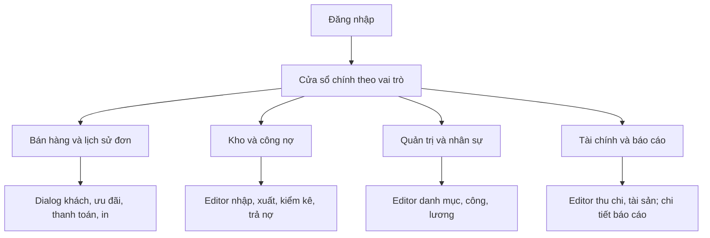
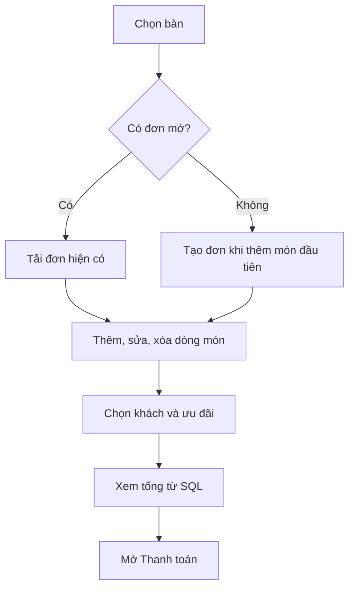
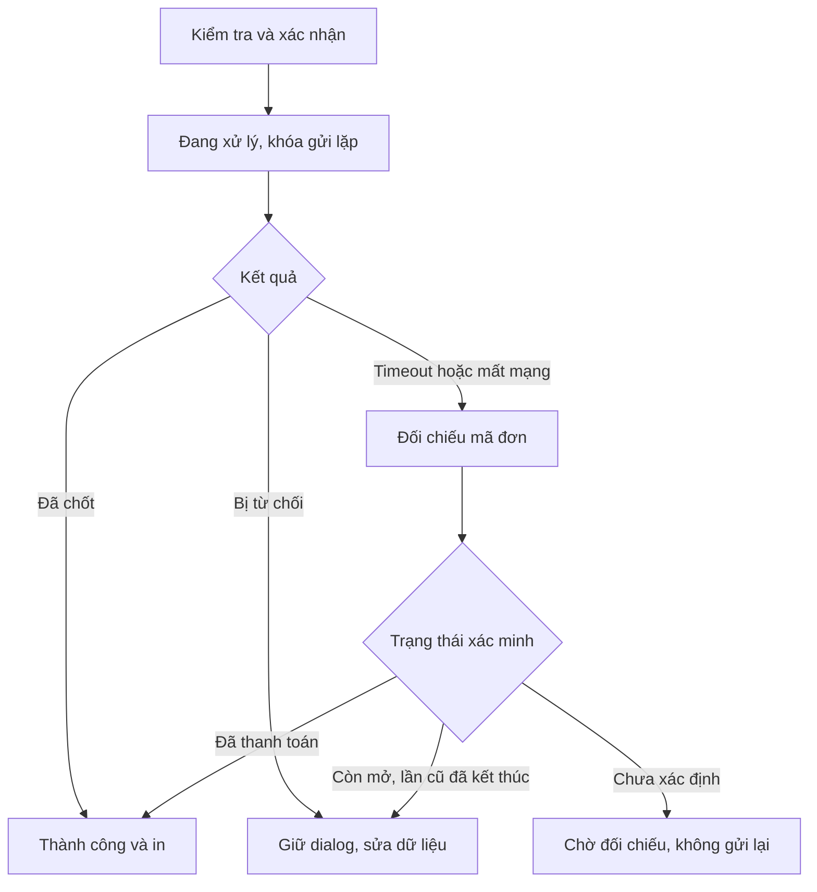
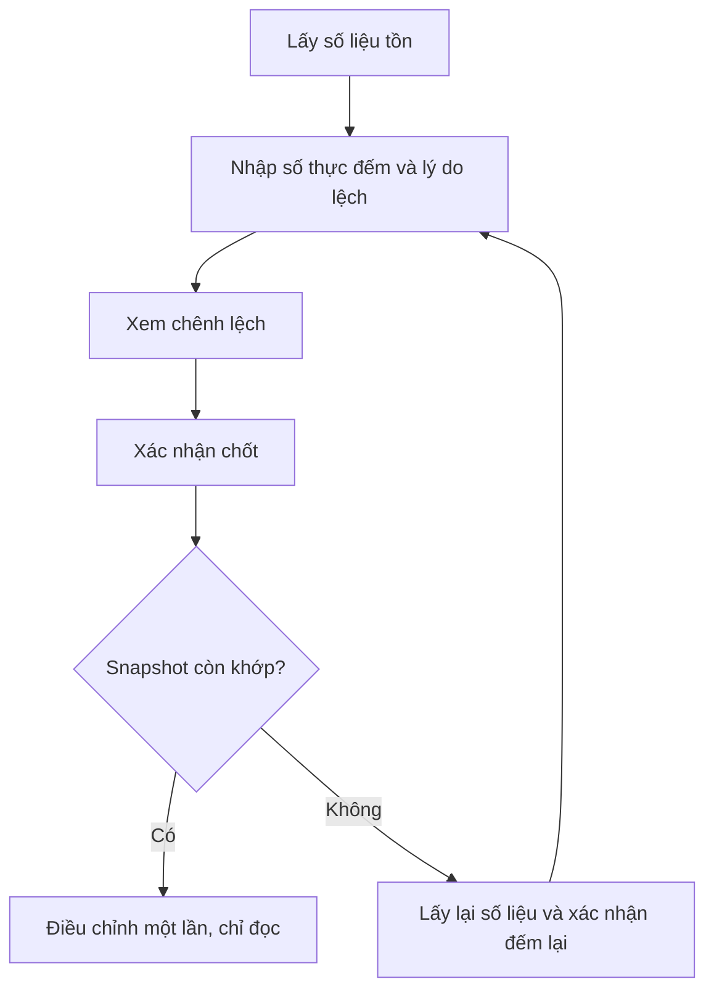

# Thiết kế UX — WinForms Quản lí quán cafe

**Phiên bản:** 1.0 — 07/10/2026.  
**Người thực hiện:** Nguyễn Minh Phú, một người.  
**Đối chiếu:** `KeHoach_QuanLiQuanCafe.md` phiên bản 3.0, schema `QuanLyCafe_ERP_V2`.  
**Trạng thái:** Thiết kế để triển khai; chưa phải giao diện đã được lập trình hoặc thử với người dùng.

## 1. Mục tiêu và quyết định thiết kế

Giúp thu ngân bán và thu tiền nhanh; nhân viên kho lập chứng từ và đếm hàng rõ ràng; quản lý kiểm soát tiền, nhân sự và báo cáo. Màn hình tổ chức theo công việc, không tạo một màn hình cho mỗi bảng SQL.

Giả định triển khai: app desktop dùng chuột/bàn phím trên một máy, một quán, một kho; giao dịch ghi trực tiếp SQL Server. Kịch bản đồng thời vẫn được kiểm thử bằng hai cửa sổ/session. Tên trạng thái dưới đây là nhãn cho người dùng, được ánh xạ sang giá trị DB qua Models, không tự đổi enum/chuỗi DB.

Chọn một `MainForm` chứa menu trái và vùng nội dung `UserControl`, dialog cho editor/xác nhận/preview. Cách này giữ ngữ cảnh và phù hợp một người làm. Không dùng nhiều cửa sổ nghiệp vụ tự do hoặc tab không giới hạn. Màn hình POS có bố cục riêng trong cùng cửa sổ chính.

Phạm vi bám kế hoạch: tại quán/mang đi/giao hàng, khách và ưu đãi, kho/công nợ, nhân sự/lương, thu chi/tài sản/báo cáo. Chưa thiết kế đặt bàn, topping/size, gộp/tách hóa đơn, hoàn tiền đơn đã trả, đổi điểm, thanh toán trực tuyến, nhiều kho hoặc đồng bộ offline.

**Nguyên tắc:** Người dùng thấy việc cần làm và kết quả. SQL chịu trách nhiệm số tiền/số dư/trạng thái chính thức; UI không âm thầm sửa số liệu hay tính lại nghiệp vụ. Trạng thái chưa biết sau timeout phải được đối chiếu trước khi cho thao tác tiếp.

## 2. Người dùng và điểm bắt đầu

| Vai trò | Màn hình sau đăng nhập | Công việc chính | Quyền giới hạn |
|---|---|---|---|
| CASH — Thu ngân | Bán hàng | Chọn bàn, thêm món, chọn khách/ưu đãi, thu tiền, in, giao hàng | Không sửa giá/công thức/chính sách/điểm, kho, nợ hoặc báo cáo tài chính |
| STORE — Kho | Tổng quan kho | Nhập, xuất, kiểm kê, tra tồn và nợ NCC | Nợ chỉ xem; không trả nợ, nhập chi trả ngay hoặc dùng tài chính |
| ADMIN — Quản lý | Tổng quan quản lý | Toàn bộ nghiệp vụ, danh mục, nhân sự, quyền và tài chính | Không sửa tiền của chứng từ đã chốt, không tự sửa số dư |

Menu không đủ quyền bị ẩn. Trạng thái không cho sửa vẫn cho xem khi vai trò có quyền đọc. Khi gọi thao tác, Business kiểm tra quyền lại; không dựa vào việc đã ẩn nút. CASH chỉ đọc tồn cần bán, không thấy giá nhập/nợ. STORE đọc công thức để làm kho, không đổi định mức.

ADMIN có thể vào POS qua menu Bán hàng. Không tự đưa quản lý vào POS mỗi lần đăng nhập. Tổng quan STORE chỉ hiển thị tồn và chứng từ kho; tổng quan ADMIN hiển thị doanh thu hôm nay, đơn mở, công nợ và lối vào nghiệp vụ. Không hiển thị widget thiếu dữ liệu như lợi nhuận chính xác.

## 3. Sơ đồ màn hình và điều hướng

| Nhóm menu | Màn hình con | CASH | STORE | ADMIN |
|---|---|---|---|---|
| Bán hàng | POS, đơn mở, lịch sử hóa đơn, giao hàng | Có | Không | Có |
| Khách hàng | Danh sách/hồ sơ | Tìm/thêm và xem cần bán | Không | Có |
| Kho | Tồn, nhập, xuất, kiểm kê, nguyên liệu | Tồn phục vụ bán | Có | Có |
| Công nợ | Nợ theo NCC/phiếu, lịch sử trả | Không | Đọc | Có |
| Menu và ưu đãi | Sản phẩm/công thức, danh mục, KM, hạng/điểm | Đọc qua POS | Công thức | Có |
| Không gian quán | Bàn, khu vực | Qua POS | Không | Quản trị |
| Nhân sự | Nhân viên/tài khoản, ca/công, bảng lương | Không | Không | Có |
| Tài chính | Thu chi, tài sản | Không | Không | Có |
| Báo cáo | Doanh thu, món/kênh/phương thức, kho/nợ/công/lương/thu chi | Không | Kho/nợ được phép | Có |
| Hệ thống | Thông tin, đăng xuất; cấu hình/sao lưu quản trị | Giới hạn | Giới hạn | Có |

Thanh đầu cửa sổ: tên quán, tiêu đề màn hình, tên người đăng nhập/vai trò, ngày nghiệp vụ, trạng thái kết nối và Đăng xuất. Không đưa mã connection string hoặc thông báo SQL lên thanh này.

Điều hướng chỉ đổi vùng nội dung; không reset bộ lọc của màn hình khi quay lại trong cùng phiên. Màn hình có nháp chưa ghi hiển thị xác nhận **Ở lại / Bỏ nháp và rời**. Nháp không được ghi DB tự động. Đơn mở đã lưu là dữ liệu DB; rời POS không hủy đơn. Đăng xuất xóa session và ngữ cảnh khách/đơn khỏi UI sau khi xử lý nháp.

## 4. Danh mục màn hình và ưu tiên

| ID | Màn hình / dialog | Nội dung chính | Task kế hoạch |
|---|---|---|---|
| UX01 | Đăng nhập; thiết lập kết nối/quản trị đầu tiên | Xác thực, lỗi kết nối, bootstrap cài mới | T06, T30 |
| UX02 | MainForm/tổng quan | Điều hướng, quyền, tải dữ liệu | T07 |
| UX03 | POS/đơn mở | Bàn, menu, chi tiết đơn, preview tiền | T11, T14, T16 |
| UX04 | Chọn/thêm khách; chọn ưu đãi | Tìm SDT, thông tin, preview SQL | T12, T13, T16 |
| UX05 | Thanh toán và kết quả | Phân bổ, tiền đưa/thối, đối chiếu trạng thái | T15, T16 |
| UX06 | Lịch sử/chi tiết hóa đơn/in | Bộ lọc, đọc snapshot, preview/in lại | T17 |
| UX07 | Giao hàng | Đơn giao, người nhận, tiến độ | T18 |
| UX08 | Khách/hạng/điểm/KM | Hồ sơ và chính sách, lịch sử điều chỉnh | T12, T13 |
| UX09 | Menu/công thức/bàn/danh mục | Grid và editor theo nhóm | T08–T11 |
| UX10 | Tồn/nguyên liệu | Đơn vị, tồn mở sổ và tồn hiện tại | T09, T20–T22 |
| UX11 | Nhập hàng | Nháp, trả ngay/nợ, chốt | T20 |
| UX12 | Xuất hàng | Hủy hỏng/trả hàng, chốt | T21 |
| UX13 | Kiểm kê | Snapshot, nhập số đếm, xử lý lệch | T22 |
| UX14 | Công nợ/trả nợ | NCC/phiếu, số dư, lịch sử | T23 |
| UX15 | Thu chi/tài sản | Nguồn chi và hồ sơ tài sản | T19, T27 |
| UX16 | Nhân viên/tài khoản | Hồ sơ, role, khóa tài khoản | T24 |
| UX17 | Chấm công | Lịch/grid, giờ đầy đủ, kỳ khóa | T25 |
| UX18 | Chốt/chi lương | Preview, snapshot, kết quả chi | T26 |
| UX19 | Báo cáo | Filter, tổng hợp và drill-down chứng từ | T28 |
| UX20 | Sao lưu/khôi phục/cấu hình | Hướng dẫn và trạng thái vận hành | T30, T32 |

Các ID là định danh thiết kế, không bắt buộc 20 Form. Editor dùng chung mẫu khi phù hợp. UX03–UX06 hoàn thiện trước các phân hệ mở rộng; bản UX không thêm task/lịch tuần mới vào kế hoạch.

## 5. Quy ước bố cục, tương tác và nội dung

### 5.1. Khung bố cục

Dùng font hệ thống hỗ trợ tiếng Việt, cỡ mặc định 10–11pt; tiêu đề 14–16pt. Khoảng cách nhóm 16px, control 8px ở DPI cơ sở. Control co giãn bằng Dock/Anchor/TableLayoutPanel, không đặt tọa độ cố định cho toàn form. Mục tiêu sử dụng ở 1366×768; kiểm tra 1280×720 và DPI 100/125/150%. Khi không đủ chỗ, panel cuộn hoặc danh sách chuyển chế độ gọn, không làm mất nút chốt.

Màn danh sách: tiêu đề + hành động chính; hàng filter; grid; dòng tổng/phân trang. Editor: thông tin chính trước, thông tin bổ sung sau; footer cố định với **Lưu / Hủy** hoặc **Chốt / Quay lại**. Dialog bắt buộc điền có nhãn rõ, không chỉ dùng placeholder. Cột mã đặt sau tên nếu người dùng ít dùng mã; chứng từ giữ mã nổi bật để đối chiếu.

Màu chỉ là tín hiệu bổ sung: chữ **Đang mở / Đã thanh toán / Đã hủy** và icon đi cùng màu. Chọn một màu chính cho hành động; lỗi đỏ, cảnh báo vàng, thành công xanh. Chỉ một nút hành động chính cho một bước, không đặt Lưu và Chốt cùng độ nổi bật.

### 5.2. Nhập liệu

Tiền hiển thị `81.000 ₫`, số lượng `0,0180 Kg`, ngày `dd/MM/yyyy`, giờ `HH:mm`; định dạng theo văn hóa UI, truyền số/ngày có kiểu về DAL. Tiền nghiệp vụ không nhập số âm; nguyên liệu hiển thị đơn vị sát ô lượng. SDT là chuỗi, không mất số 0 đầu. Trim input; trống tùy chọn thành NULL theo hợp đồng.

Lỗi trường dùng ErrorProvider và thông báo gần trường, focus vào lỗi đầu tiên. Lỗi nghiệp vụ DB xuất hiện ở vùng thông báo của dialog, giữ input để sửa. Không dùng MessageBox cho từng trường và không xóa toàn form khi lưu thất bại. Giá trị nhập phải được xác nhận trước khi rời ô/bước.

Combobox chọn dữ liệu có tên rõ, chỉ dùng mã khi trùng tên. Grid chỉ đọc trừ màn hình nhập số đếm/chấm công/chi tiết nháp có kiểm soát. Không cho chỉnh số dư trực tiếp từ grid.

### 5.3. Bàn phím và khả năng tiếp cận

Tab theo thứ tự nhìn, focus ban đầu vào trường hữu ích; nhãn có mnemonic nếu không trùng trong màn hình. Enter ở ô tìm kiếm thực hiện tìm, Enter ở editor đơn giản có thể Lưu khi hợp lệ. **Enter không tự chốt thanh toán, kiểm kê, trả nợ hoặc lương**; người dùng phải kích hoạt nút xác nhận có tên rõ. Esc đóng dialog không đang ghi, có hỏi bỏ nháp nếu cần.

POS dùng F2 tìm món, F3 chọn khách, F4 xem đơn mở, F8 mở dialog thanh toán; phím không thực hiện chốt trực tiếp và vô hiệu khi modal khác đang mở. Tooltip ghi phím cạnh nút. Không lấy phím hệ thống như Alt+F4 làm phím nghiệp vụ.

Control có AccessibleName, trạng thái không chỉ màu, thứ tự tab đúng, vùng lỗi đọc được. Kiểm tra thao tác không cần chuột cho luồng đăng nhập/bán hàng cơ bản; không buộc hover để đọc thông tin quan trọng.

## 6. Luồng đăng nhập và phiên làm việc

1. Mở app → kiểm tra cấu hình kết nối → nếu thiếu mở thiết lập lần đầu. Không yêu cầu người dùng thường nhập server mỗi lần.
2. Login có Tên đăng nhập, Mật khẩu, Hiện mật khẩu, Đăng nhập. Chưa tự thêm ghi nhớ mật khẩu hoặc tự đăng nhập.
3. Khi gửi, khóa nút và báo **Đang đăng nhập…**; giữ form, không mở MainForm trước khi xác thực xong.
4. Sai tài khoản/mật khẩu: **“Tên đăng nhập hoặc mật khẩu không đúng.”** Khóa/nghỉ việc: thông báo không được đăng nhập. Lỗi DB: **“Chưa kết nối được dữ liệu. Kiểm tra kết nối rồi thử lại.”** Không gộp lỗi DB thành sai mật khẩu.
5. Thành công → MainForm đúng vai trò. Màn đích tải thất bại vẫn hiện khung app và nút Thử tải lại; không hiển thị tổng 0 giả.
6. Đăng xuất → xử lý nháp → xóa session → về Login. Đóng app không tự hủy đơn mở.

Cài mới không seed: người cài có bước thiết lập DB và tạo ADMIN đầu tiên theo T06/T30. Không đưa tài khoản demo/mật khẩu mặc định vào màn đăng nhập của bản sử dụng. Tài khoản bị khóa trong phiên: khi kiểm tra session/quyền lại, chặn thao tác mới, báo lý do và đưa về Login; không gián đoạn giả vờ đã rollback một giao dịch đang được SQL xử lý.

## 7. POS — chọn đơn và gọi món

### 7.1. Bố cục

| Vùng | Hiển thị / thao tác |
|---|---|
| Trái, khoảng 20% | Tại quán/Mang đi/Giao hàng; khu vực, bàn; lối vào Đơn mở |
| Giữa, khoảng 45% | Tìm món, danh mục, danh sách món với giá/trạng thái |
| Phải, khoảng 35% | Mã đơn/bàn/khách, dòng món, ưu đãi, tổng SQL, nút Thanh toán |

Ở màn nhỏ, bảng bàn thu gọn thành panel chọn; vùng đơn và nút thanh toán vẫn nhìn thấy. Danh sách món có thể là grid chuẩn thay card ảnh để giảm công sức; ảnh không là điều kiện bán hàng.

Bàn có nhãn **Trống / Có đơn mở**, không hiển thị “Đã đặt” vì chưa có đặt bàn. Chọn bàn có đơn mở thì mở đơn đó, không hỏi tạo thêm. Đổi khu vực không đổi đơn đang thao tác. Có nút Làm mới bàn; tải thất bại giữ dữ liệu cũ với nhãn **Chưa cập nhật**, không giả bàn trống.

### 7.2. Tại quán

Chọn bàn trống chỉ chọn ngữ cảnh; chưa tạo hóa đơn rỗng ngay. Thêm món đầu tiên gọi nghiệp vụ tạo header và dòng đầu theo hợp đồng T14; nếu hợp đồng tách hai lệnh, phải có cơ chế dọn header rỗng hợp lệ và không để bàn chiếm giả. Đây là yêu cầu cần chốt ở T14, không giả định schema hiện tại đã hỗ trợ thao tác gộp.

Mỗi dòng: tên, số lượng, giá snapshot, ghi chú, thành tiền; nút sửa/xóa theo dòng. Thêm cùng món/cùng giá/cùng ghi chú có thể tăng số lượng bằng thao tác sửa rõ ràng; khác ghi chú hoặc giá thì giữ dòng riêng. Dialog sửa ghi chú/số lượng không đổi giá snapshot. Không cho thu ngân nhập giá tùy ý.

Thao tác ghi đang chạy khóa dòng liên quan và nút Thanh toán; không phát lệnh sửa chồng nhau. SQL trả DTO mới thì cập nhật tổng. Version xung đột: **“Đơn đã thay đổi ở phiên khác. Tải lại trước khi tiếp tục.”** Giữ bản nhập chưa gửi để người dùng tham khảo, không ghi đè tự động.

Món ngừng bán/thiếu công thức hiển thị không chọn được nếu dữ liệu biết trước. Khả năng đủ nguyên liệu chỉ là tham khảo trước checkout; SQL quyết định cuối. Không cam kết còn hàng chỉ từ tồn đã tải.

### 7.3. Mang đi và giao hàng

Mang đi: chọn tab → Đơn mới → thêm món đầu tạo đơn → quản lý bằng mã/giờ/khách ở danh sách đơn mở. Không gán bàn giả. Giao hàng thêm tên người nhận, SDT, địa chỉ, phí ship và đối tác hoặc Tự giao. Cho nhập thông tin trước, nhưng không thanh toán/chốt khi thiếu trường bắt buộc.

Đổi loại đơn khi còn mở phải qua editor và SQL kiểm tra: bỏ bàn khi chuyển mang đi/giao; bổ sung bàn khi chuyển tại quán; xóa dữ liệu đối tác không còn phù hợp sau xác nhận. Nếu T14 chưa hỗ trợ chuyển loại thì khóa loại sau tạo và hướng dẫn tạo lại trước phát sinh; không chỉ đổi label trên UI.

### 7.4. Khách và ưu đãi

Dialog chọn khách tìm SDT/tên → chọn kết quả có tên, SDT che vừa đủ theo ngữ cảnh, hạng/điểm → Áp dụng. Khách mới: nhập tên/SDT tùy chọn theo schema, lưu rồi chọn ngay. Vãng lai là bỏ chọn khách, không tạo hồ sơ tên “Khách lẻ” cho mọi đơn.

Ưu đãi có lựa chọn **Không chọn chương trình / Chọn chương trình hợp lệ**. Có chương trình thì thay ưu đãi hạng, không cộng dồn. Khi không chọn KM, SQL vẫn áp dụng hạng nếu có khách; nhãn “Không chọn chương trình” không có nghĩa tổng giảm luôn bằng 0. Hiển thị nguồn giảm và tỷ lệ từ preview SQL. Nếu chưa có hợp đồng lưu lựa chọn KM/khách vào đơn, T13/T14 phải bổ sung trước khi UI cho Áp dụng.

Khách đổi/ưu đãi đổi → tải preview → cập nhật tổng; không cho Thanh toán khi preview đang tải hoặc thất bại. Điểm hiển thị trước thanh toán là điểm hiện tại; **Điểm dự kiến** ghi rõ tham khảo. Không có nút Dùng điểm.

### 7.5. Hủy và rời đơn

Rời đơn lưu không hủy; chọn đơn khác sau khi kết thúc ghi đang chạy. Hủy có dialog mã đơn, bàn, tổng, cảnh báo không hoàn tiền vì chỉ đơn chưa thanh toán; yêu cầu lý do nếu contract hỗ trợ lưu, không hỏi rồi làm mất lý do. Nếu schema chưa lưu lý do, ghi rõ cần bổ sung ở T16 hoặc chỉ dùng xác nhận.

Đơn đã pha rồi hủy: hướng dẫn ADMIN/STORE lập xuất hủy lượng thực dùng qua UX12; không tự cộng tồn hay ghi tiêu hao bán. Đơn đã trả chỉ xem/in/chuyển tiến độ giao, không hiện nút Hủy tài chính.

## 8. Thanh toán — luồng trọng tâm

### 8.1. Dialog xác nhận

Phần trên: mã đơn, bàn/loại, khách, tiền món, nguồn giảm, tiền giảm, ship, **Phải trả**. Phần giữa: dòng phương thức, số tiền, mã tham chiếu; Thêm dòng/Xóa dòng. Phần dưới: Đã phân bổ, Còn thiếu/Dư, tiền khách đưa/thối nếu có tiền mặt; nút **Quay lại / Xác nhận thanh toán**.

Mặc định một dòng tiền mặt bằng số phải trả; không tự mặc định phương thức không được hỗ trợ. PT010 đổi điểm bị ẩn. Có thể nhiều phương thức, cùng phương thức nhiều dòng nếu cần tham chiếu khác. Mã tham chiếu không có nghĩa đã được ngân hàng xác minh; app chưa kết nối thanh toán trực tuyến.

Tiền đưa/thối chỉ phục vụ thao tác tiền mặt: tổng phải trả 81.000, phân bổ tiền mặt 81.000, đưa 100.000 → thối 19.000. Thanh toán hỗn hợp chỉ tính tiền đưa/thối trên phần tiền mặt. DB lưu số thu đúng phân bổ, không lưu tiền đưa như doanh thu. Dữ liệu này chưa lưu thì in lại không hiển thị một số được dựng lại.

Phải trả 0 do giảm 100%, ship 0: không bắt thêm dòng tiền 0; nút đổi nhãn **Chốt hóa đơn 0 ₫**. Người dùng vẫn xác nhận và SQL vẫn tiêu hao/ghi trạng thái.

### 8.2. Trạng thái và nhánh phục hồi

Trong khi gửi, không đóng dialog và không bắt đầu thanh toán khác trên cùng đơn. Không coi việc hủy chờ HTTP/task UI là hủy transaction SQL. Nếu quyền đóng cửa sổ hệ thống vẫn xảy ra, khi mở lại phải đối chiếu trạng thái đơn.

| Tình huống | Phản hồi UX | Hành động tiếp |
|---|---|---|
| Phân bổ thiếu/dư | Báo chênh lệch sát bảng tiền | Sửa trước xác nhận |
| Preview thay đổi | Hiện số cũ/mới và nguồn thay đổi | Tải preview, người dùng xác nhận số mới |
| Thiếu nguyên liệu | Danh sách NVL/thiếu nếu SQL trả, thông báo đơn chưa chốt | Quay lại sửa món hoặc nhờ kho |
| Món ngừng bán/thiếu công thức | Chỉ rõ món | ADMIN xử lý hoặc bỏ món |
| Đơn đã chốt ở phiên khác | Tải kết quả thực | Xem/in, không thu lần hai |
| Mất kết nối/timeout | “Chưa xác định kết quả. Đang kiểm tra hóa đơn …” | Nút Kiểm tra lại; chặn xác nhận mới |
| In lỗi sau thành công | “Đã thanh toán. Chưa in được hóa đơn.” | In lại/Xem hóa đơn; không gọi checkout |

Kết quả thành công: mã, tiền thu, phương thức, điểm đã cộng nếu có, In/Xem chi tiết/Đơn tiếp theo. Chỉ sau SQL xác nhận commit mới làm trống bàn và kết thúc đơn ở POS. In không phải điều kiện thanh toán thành công.

## 9. Lịch sử hóa đơn, in và giao hàng

Lịch sử: ngày thanh toán hoặc ngày lập được chọn và ghi rõ, trạng thái, loại đơn, bàn/khách, mã; grid phân trang. Chọn dòng mở chi tiết đọc snapshot giá/giảm/ship/phí, phân bổ và trạng thái. Từ đơn mở có quyền quay lại POS; từ đơn đã trả chỉ xem/in. Không chỉnh chứng từ qua grid lịch sử.

Preview in trước khi gửi máy in. In hiện tên quán, mã/ngày, món/số lượng/giá, tiền món/giảm/ship/phải trả và phương thức; không lộ chi phí đối tác nếu không cần cho khách. Hóa đơn nhiều dòng phải phân trang đúng. In lại có nhãn In lại; không tự gọi là hóa đơn VAT. Lỗi không có máy in vẫn xem được preview và đóng bình thường.

Giao hàng: các nhóm Chờ xử lý/Đang giao/Đã giao theo trạng thái thực được hỗ trợ. Trạng thái thanh toán hiển thị riêng, không suy ra đã trả từ Đã giao. Chọn đơn → chi tiết người nhận/đối tác → nút chuyển bước hợp lệ → xác nhận → reload. Đơn đã trả thay tiến độ không thay tài chính. Giao thất bại của đơn đã trả được ghi nhận/hướng dẫn xử lý thủ công theo contract, không phát sinh hoàn tiền tự động.

Không hứa lưu lịch sử chuyển trạng thái nếu DB chỉ có trạng thái hiện tại; muốn timeline cần bổ sung lưu vết tại T18 trước khi hiển thị. Lịch sử hóa đơn vẫn xem được đơn giao hoàn tất.

## 10. Quản trị khách, menu và bàn

### 10.1. Mẫu danh sách/editor

Tìm/lọc → grid → Thêm hoặc Chọn dòng/Sửa → dialog → validation → Lưu → reload dòng vừa sửa. Thành công dùng thông báo nhẹ; xóa/ngừng hoạt động phải xác nhận theo mức tác động. FK đang được dùng thì báo không thể xóa và đề nghị ngừng sử dụng nếu schema có trạng thái; không tự thêm soft-delete bằng UI.

Sản phẩm: tên, danh mục, giá, bán/ngừng; tab Công thức có NVL, lượng và đơn vị chuẩn. Không cho bật bán nếu thiếu công thức theo chính sách checkout. Công thức 18g cho NVL Kg nhập 0,0180 Kg và có gợi ý quy đổi đọc được, không âm thầm đổi đơn vị.

Bàn/khu vực: số/tên, khu vực, trạng thái hỗ trợ. Không xóa bàn có đơn mở. Màn quản trị không có nút tự đặt bàn thành trống để né hóa đơn. Danh mục nhỏ dùng tab trong cùng màn, tránh 35 màn hình riêng.

### 10.2. Khách, hạng và chương trình

Hồ sơ khách có thông tin liên hệ, hạng/điểm chỉ đọc, lịch sử hóa đơn được phép, tab lịch sử điểm. ADMIN Điều chỉnh điểm mở dialog cộng/trừ, lượng điểm và lý do; preview số dư, xác nhận rồi ghi lịch sử. Không có ô sửa DiemTichLuy trong editor hồ sơ.

Chính sách hạng có ngưỡng và tỷ lệ; thay đổi báo **“Hạng khách sẽ được tính lại theo chính sách mới.”** Xác nhận rồi gọi SQL nguyên tử, không hiện trạng thái hoàn tất khi chỉ sửa một phần. Chương trình có ngày bắt đầu/kết thúc, tỷ lệ; cùng ngày hợp lệ. UI ghi đơn cũ giữ snapshot, không hứa thay chính sách sẽ sửa lịch sử.

## 11. Kho — tồn, nhập, xuất và kiểm kê

### 11.1. Tồn và nguyên liệu

Danh sách tồn hiển thị NVL, đơn vị chuẩn, tồn hiện tại, lần cập nhật và lối vào nguồn nhập/xuất/tiêu hao/kiểm kê. Không hiển thị cảnh báo “Sắp hết” nếu chưa có ngưỡng được lưu; có thể thêm sau khi bổ sung yêu cầu và dữ liệu. Mở sổ là thao tác ADMIN một lần với mốc/nguồn; sau đó editor không có ô sửa tồn. Đổi đơn vị nguyên liệu đã phát sinh bị chặn và giải thích.

### 11.2. Nhập hàng

1. Danh sách → Lập phiếu; nháp trong bộ nhớ, nhãn **Chưa ghi kho**.
2. Chọn NCC, ngày, thêm NVL/lượng/giá theo đơn vị. Mỗi NVL một dòng; chọn trùng đưa focus dòng cũ để sửa, không gửi PK trùng.
3. Tổng tiền theo preview SQL/công thức chuẩn đã chốt. ADMIN nhập trả ngay [0,tổng], còn nợ hiển thị; STORE trả ngay khóa 0 và ghi “Thanh toán do quản lý xử lý”.
4. Xem lại → **Chốt nhập kho**; nêu lượng/tổng/trả ngay/nợ.
5. Commit thành công → chi tiết chỉ đọc, xem phiếu chi/nợ nguồn khi có quyền. Lỗi giữ nháp; không tăng tồn giả trên grid.

Không có Lưu nháp DB nếu chưa bổ sung hợp đồng; nút Hủy bỏ nháp hỏi xác nhận. Chốt không cho sửa NCC/ngày/chi tiết. Timeout đối chiếu mã/yêu cầu theo contract T20; không tạo phiếu mới ngay. Cần mã yêu cầu hoặc cấp mã ổn định trước gửi để tra cứu chắc chắn; không dùng NCC+tổng tiền như khóa nhận dạng.

### 11.3. Xuất hàng

Danh sách → Lập phiếu → chọn Hủy do hỏng hoặc Trả hàng, ngày/lý do/NVL/lượng → xem lại → Chốt xuất → chi tiết chỉ đọc. Thiếu một NVL thì báo cả phiếu chưa chốt; không cho UI tự bỏ dòng thiếu rồi ghi phần còn lại. Nhãn Trả hàng ghi rõ chưa tự hoàn tiền/cấn nợ. Không có xuất chuyển kho/quầy cho mô hình một kho.

### 11.4. Kiểm kê

Hiển thị thời điểm snapshot, tồn hệ thống, tồn thực, chênh lệch, đơn vị, lý do. Ô chưa đếm để trống, không mặc định 0 rồi coi đã đếm. Có thể nút Điền bằng hệ thống cho dòng chọn nhưng phải được người dùng chủ động xác nhận; chốt bắt buộc đủ số đếm cho scope phiếu.

Khi phát sinh kho làm lệch snapshot, báo dòng đổi nếu SQL hỗ trợ. Lấy lại không âm thầm giữ số thực cũ rồi chốt; giữ bản đếm tham khảo riêng hoặc hỏi xác nhận nhập lại. Chốt hôm nay, tạm ngừng phát sinh liên quan; không giữ khóa DB trong cả thời gian đếm. Đã chốt không có nút Chốt lại/Reset.

## 12. Công nợ và thu chi

Công nợ: chọn NCC → phiếu nhập/nợ gốc/đã trả/còn nợ → lịch sử từng lần. Bộ lọc **Hiện tại / Tại ngày** ghi rõ; chế độ ngày dùng query lịch sử phù hợp, không lọc view số dư hiện tại rồi coi là quá khứ.

ADMIN chọn Trả nợ → nguồn PN/NCC chỉ đọc, số còn nợ, số trả, ngày và thông tin chi theo contract → xác nhận → SQL tạo chi/lịch sử → hiện số dư và phiếu chi. STORE không có nút trả. Vượt nợ hoặc cạnh tranh phiên khác thì tải số dư mới và yêu cầu sửa, không ép số trả xuống tự động.

Thu chi có phân biệt **Ghi tay / Từ nghiệp vụ**. Editor ghi tay chỉ cho danh mục được phép; chi nhập trả ngay/trả nợ/lương mở chứng từ nguồn và chỉ đọc. Không ghi thêm phiếu thu cho checkout. Báo cáo/danh sách ghi nguồn rõ để tránh người dùng ghi lần hai. Không có Sửa/Xóa lịch sử hệ thống.

Timeout trả nợ/chi là kết quả chưa biết: giữ mã yêu cầu, tra cứu nguồn và phiếu chi trước thử lại. UI phải có nút Kiểm tra kết quả. Nếu SQL chưa cung cấp khóa tra cứu chắc chắn, phải bổ sung ở task nghiệp vụ trước khi đưa chức năng vào sử dụng.

## 13. Nhân sự, công và lương

Nhân viên: grid hồ sơ, chức vụ, hợp đồng, mức lương, hoạt động; tài khoản ở tab riêng có role và khóa. Chức vụ không tự suy ra role. Nghỉ việc có xác nhận ảnh hưởng tài khoản và giữ lịch sử; không xóa nhân viên đã phát sinh. Đổi mật khẩu không hiển thị hash; không khóa ADMIN hoạt động cuối.

Chấm công: chọn kỳ/nhân viên → grid ngày/ca/trạng thái/giờ vào/ra đầy đủ ngày → editor. Ca qua đêm hiển thị cả ngày ra; ngày làm là cơ sở kỳ. Ca thiếu giờ ra có nhãn Chưa hoàn tất; không tự điền giờ ca mẫu như giờ thực. Overlap hiển thị ca xung đột nếu SQL trả. Kỳ lương chốt chỉ đọc, nút sửa bị khóa có lý do.

Chốt lương: chọn kỳ → tải giờ hợp lệ/các vấn đề → ADMIN duyệt giờ thường, giờ/tiền tăng ca, phụ cấp/thưởng/khấu trừ → Preview từ SQL → xem công thức và thực lĩnh → **Chốt bảng lương**. Ca thiếu/overlap phải giải quyết trước. Nhãn giờ tăng ca và tiền tăng ca tách rõ, không tự tính chính sách chưa chốt.

Bảng lương chốt có hai trạng thái riêng **Đã chốt / Chưa chi** và **Đã chi**. Chọn Chi lương → thực lĩnh/nhân viên/kỳ chỉ đọc → xác nhận trả toàn bộ → xem phiếu chi. Thực lĩnh 0 dùng nhãn Không phát sinh chi, không tạo phiếu 0. Không nút chi lần hai/tạm ứng/chia đợt. Đổi hồ sơ lương không thay snapshot đã chốt.

## 14. Tài sản, báo cáo và hệ thống

Tài sản: hồ sơ tên/nguyên giá/ngày mua/thời gian khấu hao/trạng thái theo schema. Chọn tài sản thấy khấu hao **tham khảo** và chi sửa chữa gắn nguồn. Lưu hồ sơ không tự tạo phiếu chi mua. Không gọi khấu hao là dòng tiền.

Báo cáo: nhóm chọn loại → filter ngày/kênh/phương thức/NCC/nhân viên theo loại → **Xem báo cáo** → tổng + grid. Thay filter đánh dấu cần tải lại; không để tiêu đề kỳ mới trên số cũ. Query mới thay query cũ: kết quả trả muộn bị bỏ, không ghi đè. Có loading, rỗng, lỗi, Thử lại. Chọn số/dòng được phép mở chứng từ nguồn và Quay lại giữ filter.

Doanh thu theo ngày thanh toán; tiền món, giảm, ship, khách trả, phí đối tác tách rõ. Báo cáo món trước giảm toàn bill ghi nhãn rõ nếu chưa có phân bổ. Công nợ ngày có cutoff đúng. Thu chi quản trị không gọi số dư ngân hàng khi chưa đối soát, không có widget Lợi nhuận chính xác.

Cấu hình/sao lưu ADMIN: chỉ hiển thị tham số cần vận hành, mật khẩu che, nút Kiểm tra kết nối trước Lưu. Backup có nơi lưu phía SQL Server, không nhầm đường dẫn máy app; có quyền thì thao tác qua cơ chế đã kiểm thử, thiếu quyền có hướng dẫn. Restore không là nút cho người thường; quy trình quản trị đóng phiên app, xác nhận DB đích, khôi phục và kiểm tra theo T30. Không nhét công cụ quản trị SQL tổng quát vào UX.

## 15. Ma trận trạng thái dùng chung

| Trạng thái | Hiển thị | Nút / dữ liệu | Quy tắc |
|---|---|---|---|
| Đang tải | Loading trong vùng nội dung | Khóa thao tác cần dữ liệu | Không freeze toàn cửa sổ |
| Có dữ liệu | Grid/tổng + thời điểm cập nhật | Theo quyền/trạng thái | Không cộng lại số SQL ở UI |
| Rỗng | “Chưa có … trong bộ lọc này” | Đổi filter/Thêm nếu được | Tổng 0 chỉ khi query thành công |
| Lỗi tải | Thông báo và Thử lại | Dữ liệu cũ ghi Chưa cập nhật | Không giả thành rỗng |
| Nháp thay đổi | Nhãn Chưa lưu/Chưa ghi kho | Hỏi khi rời | Không auto-commit |
| Đang ghi | “Đang xử lý…” | Khóa gửi/đóng dialog nghiệp vụ | Không cho gửi lặp |
| Validation sai | Lỗi tại trường | Giữ input, focus lỗi | Không gửi nếu sai rõ tại UI |
| Bị SQL từ chối | Lý do nghiệp vụ | Sửa/tải lại theo lỗi | Không báo thành công |
| Xung đột phiên | Dữ liệu đã thay đổi | Tải lại, xác nhận mới | Không ghi đè tự động |
| Kết quả chưa biết | Mã giao dịch + Đối chiếu | Chặn gửi lại nguồn đó | Không coi timeout là rollback |
| Đã chốt | Badge và chi tiết chỉ đọc | Xem/in/nguồn hợp lệ | Không sửa tài chính |
| Không đủ quyền | Menu ẩn hoặc lý do rõ | Business chặn lại | Không chỉ khóa control |

Dialog xác nhận phải có tên thao tác, mã nguồn, số tiền/lượng liên quan và hậu quả. Ví dụ: **“Thanh toán hóa đơn HD… với số tiền 81.000 ₫? Sau khi hoàn tất không thể sửa tiền/món.”** Nút dùng tên hành động, tránh Có/Không thiếu ngữ cảnh.

Thông báo thành công thường không cần modal. Giao dịch tiền/kho có trang kết quả để đọc/tra cứu. Lỗi kỹ thuật hiển thị mã lỗi hỗ trợ và lời hướng dẫn, log chi tiết ở tầng phù hợp; không cho người dùng thấy stack trace hay connection string.

## 16. Trạng thái chứng từ và tính toàn vẹn UX

| Đối tượng | Trước ghi/chốt | Sau ghi/chốt | Nơi xem lại |
|---|---|---|---|
| Hóa đơn | Đơn mở lưu DB, cho sửa theo SQL | Đã trả/đã hủy, khóa tài chính | Lịch sử/chi tiết |
| Nhập/xuất | Nháp local, không đổi kho | Chứng từ chốt, chỉ đọc | Danh sách kho |
| Kiểm kê | Snapshot và số đếm theo contract | Đã điều chỉnh, khóa header/chi tiết | Chi tiết kiểm kê |
| Trả nợ | Dialog chưa ghi | Lịch sử trả + chi liên kết | Nợ nguồn/thu chi |
| Bảng lương | Preview/khoản duyệt | Chốt snapshot, chi là bước riêng | Kỳ lương/phiếu chi |
| Điểm | Preview điều chỉnh | Lịch sử, không sửa số dư | Hồ sơ khách |

Không dựng trạng thái “Đã chốt” chỉ từ dữ liệu local. Mọi kết quả thành công dùng DTO hoặc đọc lại nguồn DB. Form không giữ khóa SQL khi người dùng nhập, đọc xác nhận hoặc in.

## 17. Hợp đồng cần chốt trước khi code UI

Đây là yêu cầu triển khai thuộc task hiện có, không xác nhận schema đã hỗ trợ. Tên DTO có thể thay đổi, nhưng kết quả cần đủ để phục vụ luồng UX.

| Luồng | Dữ liệu SQL/BLL cần trả | Task |
|---|---|---|
| POS và sửa đơn | Mã/version/trạng thái, dòng và giá snapshot, tổng/nguồn ưu đãi | T13–T14 |
| Tạo đơn với món đầu | Tạo nguyên tử hoặc cơ chế header rỗng không chiếm bàn sai | T14 |
| Checkout | Preview chính thức, kết quả chốt, lỗi nghiệp vụ, cách tra trạng thái theo MaHD | T15–T16 |
| Nhập/xuất/trả nợ/chi lương | Mã nguồn hoặc request ID ổn định và cách tra kết quả sau timeout | T19–T23, T26 |
| Kiểm kê | Thời điểm snapshot, số liệu theo dòng, phản hồi snapshot lỗi thời | T22 |
| Chấm công/lương | Ca xung đột/chưa đủ giờ, trạng thái kỳ chốt, preview và thực chi | T25–T26 |
| Giao hàng | Bước chuyển hợp lệ, quyền và khả năng lưu lịch sử nếu triển khai | T18 |
| Báo cáo | Metadata filter/thời điểm, aggregate không nhân dòng, phân trang | T28 |

Nếu không có trường để lưu lý do hủy/lịch sử giao, không hiển thị như dữ liệu đã được lưu. Điều chỉnh UX và contract cùng task, không lưu tạm rồi đánh lừa người dùng rằng lịch sử bền vững.

## 18. Kiểm thử UX và tiêu chí nghiệm thu

Các ca này bổ sung phần trải nghiệm cho kiểm thử nghiệp vụ ở kế hoạch; không thay 325 ca kiểm thử đã có. Chuẩn bị ADMIN/CASH/STORE, bàn trống/có đơn, khách có hạng, KM hợp lệ/hết hạn, món thiếu nguyên liệu, nợ còn dư và kỳ công chưa hoàn tất. Kết quả nghiệm thu ghi dữ liệu đầu vào, thao tác, expected/actual, ảnh khi cần; không đánh dấu PASS chỉ vì đã có form.

| ID | Thao tác / tình huống | Kết quả cần đạt |
|---|---|---|
| UX-K01 | Login đủ ba role | Đến đúng màn, menu và quyền đúng |
| UX-K02 | Sai mật khẩu so với mất DB | Hai thông báo khác nhau, không mở MainForm sai |
| UX-K03 | Đăng xuất khi có nháp | Có lựa chọn ở lại/bỏ; session và ngữ cảnh bị xóa khi thoát |
| UX-K04 | Khóa tài khoản đang có phiên | Thao tác mới bị chặn khi kiểm tra lại, không bypass quyền |
| UX-K05 | Chọn bàn trống rồi rời, chưa thêm món | Không để hóa đơn rỗng chiếm bàn |
| UX-K06 | Chọn bàn có đơn | Tải đúng đơn, không tạo thêm |
| UX-K07 | Thêm món, sửa lượng, hai ghi chú khác nhau | Dòng và tổng đúng, focus thuận tiện, không gộp sai |
| UX-K08 | Hai phiên sửa cùng đơn | Báo xung đột, tải lại, không ghi đè |
| UX-K09 | Khách mới/vãng lai/đổi khách | Không hồ sơ lẻ dùng chung, preview theo đúng khách |
| UX-K10 | Có hạng và chọn KM | Nguồn giảm đúng, không cộng dồn, không có Dùng điểm |
| UX-K11 | Preview đang tải/thất bại | Không thanh toán theo số cũ |
| UX-K12 | Thu 81.000, tiền mặt đưa 100.000 | Thu 81.000, thối 19.000; hiển thị đúng |
| UX-K13 | Chia 30.000 + 51.000, thiếu/dư phân bổ | Chốt đúng khi đủ; lỗi tại bảng khi lệch |
| UX-K14 | Giảm 100%, ship 0 hoặc ship >0 | Luồng 0 ₫ không tạo dòng 0; còn ship phải trả |
| UX-K15 | Preview đổi lúc xác nhận | Hiện số mới, yêu cầu xác nhận lại |
| UX-K16 | Thiếu kho khi checkout | Giữ đơn mở, báo rõ và không báo đã thu |
| UX-K17 | Double-click/Enter/F8 lặp | Chỉ một yêu cầu chốt; phím không chốt trực tiếp |
| UX-K18 | Timeout trước/sau commit | Có đối chiếu, không retry mù, trạng thái phản ánh DB |
| UX-K19 | SQL thành công nhưng in lỗi | Giữ kết quả đã trả, chỉ In lại |
| UX-K20 | Hủy đơn mở và thử hủy đơn đã trả | Luồng mở hợp lệ; đơn trả không cho hủy tài chính |
| UX-K21 | Giao hàng thiếu người nhận/địa chỉ | Chặn chốt, lỗi đúng trường |
| UX-K22 | Chuyển tiến độ đơn giao đã trả | Tiền/điểm/tồn không đổi, trạng thái riêng rõ |
| UX-K23 | Lịch sử đổi filter/ngày/đơn nhiều trang | Kỳ rõ, paging đúng, chi tiết và in dùng snapshot |
| UX-K24 | Nhập nháp rồi bỏ | Không tăng tồn/chi/nợ, có hỏi bỏ nháp |
| UX-K25 | STORE nhập so với ADMIN trả một phần | STORE không trả ngay; ADMIN thấy chi/nợ đúng nguồn |
| UX-K26 | Nhập NVL trùng, đơn vị g/kg | Focus dòng cũ; đơn vị và lượng không gây hiểu sai |
| UX-K27 | Xuất thiếu một NVL hoặc trả hàng | Không chốt một phần; không hứa tự cấn nợ |
| UX-K28 | Kiểm kê ô trống, lệch có/không lý do | Chặn số chưa đếm và thiếu lý do theo policy |
| UX-K29 | Kho đổi sau snapshot | Yêu cầu lấy/đếm lại, không tự chốt bằng dữ liệu cũ |
| UX-K30 | Chốt kiểm kê lần hai/header reset | Không có đường thao tác lại trên UI |
| UX-K31 | Trả nợ vượt, đồng thời, timeout | Reload/đối chiếu, không chi trùng, STORE chỉ xem |
| UX-K32 | Editor thu chi nguồn hệ thống | Chỉ đọc/mở nguồn, không sửa hoặc ghi lần hai |
| UX-K33 | Điều chỉnh điểm và sửa chính sách | Lý do/preview rõ, số dư chỉ đọc, không đổi lịch sử đơn |
| UX-K34 | Ca qua đêm/overlap/thiếu giờ ra | Ngày giờ rõ, lỗi xử lý trước chốt lương |
| UX-K35 | Chốt lương rồi đổi hồ sơ/chi lần hai | Snapshot giữ, khóa kỳ, không chi trùng |
| UX-K36 | Lương 0/chốt chưa chi | Nhãn phân biệt đúng, không tạo phiếu 0 |
| UX-K37 | Báo cáo rỗng, lỗi DB, query trả muộn | Không dùng 0 giả, không hiển thị số của filter cũ |
| UX-K38 | Tài sản/khấu hao | Nhãn tham khảo, không coi lưu hồ sơ là ghi chi |
| UX-K39 | Tab/Enter/Esc/F2/F3/F4/F8 | Thứ tự focus đúng, không chốt nguy hiểm hoặc mất nháp |
| UX-K40 | 1280×720, 1366×768; DPI 100/125/150% | Không cắt text/nút/footer, grid đọc và cuộn được |
| UX-K41 | Tên tiếng Việt dài, ghi chú nhiều dòng, tiền lớn | Không vỡ layout; dấu, đơn vị, số không bị mất |
| UX-K42 | Query chậm, đổi màn, đóng dialog | UI responsive; kết quả không cập nhật control đã đóng |
| UX-K43 | Đóng app/mở lại có đơn mở | Đơn được tải từ DB; không auto-hủy/auto-thu |
| UX-K44 | Kết nối/sao lưu ở bản publish | Thông báo dễ hiểu, quyền đúng, không lộ bí mật |

Nghiệm thu sau prototype: một người thử đóng vai thu ngân thực hiện bán tại quán, mang đi, thu hai phương thức và xử lý lỗi in; ghi chỗ dừng/nhầm thao tác. Tiếp theo thử kho nhập–trả nợ–kiểm kê và quản lý công–lương. Nếu chưa có người thử khác, ghi rõ self-test và làm lại bằng kịch bản mới; không tuyên bố đã kiểm chứng tính dễ dùng với người dùng thực.

Mục tiêu trải nghiệm: các thao tác thường xuyên không phải mở menu quản trị; không có bước nhập mã kỹ thuật bằng tay trong bán hàng; mọi lỗi có hành động tiếp; không mất nháp vì lỗi; mọi chốt quan trọng có nguồn, số và xác nhận rõ. Tốc độ tải phải được đo cùng T29 trên dữ liệu mẫu, không đặt kết luận hiệu năng từ bản thiết kế này.

## 19. Thứ tự hiện thực thiết kế UX

Thực hiện trong các task đã có: UX01–UX02 ở T06–T07; danh mục/bàn/khách ở T08–T13; POS/checkout/lịch sử ở T14–T17; giao ở T18; kho và tài chính ở T19–T23; nhân sự/lương/tài sản ở T24–T27; báo cáo T28; vận hành T30; kiểm thử xuyên luồng T31 và bàn giao T32.

Trước code mỗi màn, phác bố cục control và xác nhận luồng chính/lỗi theo tài liệu này. Không cần thiết kế pixel hoàn chỉnh toàn bộ 20 màn trước khi làm POS. Mỗi task bàn giao màn dùng được, trạng thái đủ và các ca UX liên quan có kết quả; không chỉ ảnh giao diện đẹp chưa gắn nghiệp vụ.

Tài liệu này là file UX riêng, không thay kế hoạch dự án hoặc schema. Khi nghiệp vụ đổi, cập nhật đồng thời màn, trạng thái, contract và ca UX liên quan theo cùng task.
